# Phone apps - design

The phone's full app screens: the tablet's theme, without the live tiles, one screen at a time.
Related:
- [DESIGN_PHONE_WALKING.md](DESIGN_PHONE_WALKING.md) for the always-on walking view;
- [DESIGN_TABLET.md](DESIGN_TABLET.md) and [DESIGN_TABLET_APPS.md](DESIGN_TABLET_APPS.md) for the theme and app data;
- [DESIGN_VOICE.md](DESIGN_VOICE.md) for RADIO and CALLS.

Canvas: TAC//APP Phone (artifact 5gFo1QBBxnchSCmcXKofWw).
Status: design, for code. Date 2026-10-30.

## What it is

- **Opened from** the walking view. The app takes over the phone screen; ESC goes back to the walking view.
- **Theme:** same as the tablet: device bar, notification line, tables, colour schemes (light / olive / sand / night). No live tiles.
- **One screen at a time.** Left / right moves through them.
- **Data:** each screen reads the same source as its tablet app. Nothing new on the server.

## View types

| Type | Design px | In game (1080p) | Used for |
|---|---|---|---|
| Full landscape | 1600 x 740 | 800 x 370 | phone raised to the face |
| Small landscape | 1030 x 440 | 515 x 220 | phone at the hip, same size as the walking view |
| Small portrait | 600 x 1000 | 300 x 500 | phone held upright; side devices use it too |

- Design px are 2x in-game px, like the other phone boards.
- Landscape screens use one row per item. Portrait stacks each row onto two lines and puts the soft keys in a 2 x 2 grid.
- The player picks the view type in SETTINGS.

Full landscape:

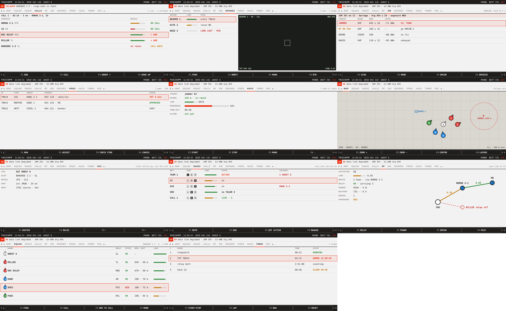

Small landscape:

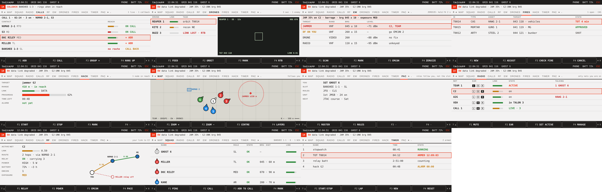

Small portrait:

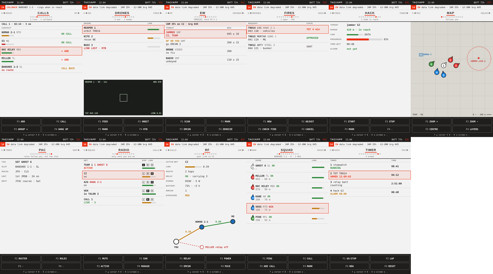

## Layout

Top to bottom:

| Row | Landscape | Portrait |
|---|---|---|
| Device bar | TAC//APP, time, grid, callsign, PHONE, battery, ESC | TAC//APP, time, battery, ESC |
| Notification line | count + newest notification (mirror of the popups) | same |
| Screen strip | all screen names, current one underlined, note on the right | previous name, current name large, next name, position dots, note under |
| Screen | the app | the app |
| Soft keys | F1-F4 in one row, 7 ▲ / ▼ 8 hints | F1-F4 in a 2 x 2 grid, hint line under |

## Keys

| Numpad | Does |
|---|---|
| 0 / . | previous / next screen (wraps at the ends) |
| 1 2 3 4 | soft keys F1 F2 F3 F4 (labels change per screen) |
| 7 / 8 | cursor up / down in lists |
| 5 | tablet (unchanged) |
| 9 | TROOPS IN CONTACT (unchanged) |
| ESC | back to the walking view |

- The mouse works too: click a screen name to jump to it, click a row to select it.
- A blank soft key shows "—".
- On the walking view 0 / . turn the net page (2026-11-07). Only inside the app do they change screens.

## Screens

Order in the strip: MAP, SQUAD, RADIO, CALLS, RF, EW, DRONES, FIRES, HACK, TIMER, PAC.
Images below are small landscape. All three sizes of every screen are in `images/phone_app_<l|s|p>_<screen>.png`.

| Screen | Shows | F1 | F2 | F3 | F4 |
|---|---|---|---|---|---|
| MAP | map, own team numbered, other groups, EW, drones | ZOOM + | ZOOM − | CENTRE | LAYERS |
| SQUAD | members: number, name, role, state, bearing / distance, link | PING | CALL | ADD TO CALL | MARK |
| RADIO | nets you are on: ear, link, state, who is talking | MUTE | EAR | SET ACTIVE | MANAGE |
| CALLS | live call, contacts, reach, + ADD / CALL BACK | ADD | CALL | GROUP + | HANG UP |
| RF | own link: net, quality, route, relay, power, battery, EMCON, exposure, mini mesh | RELAY | POWER | EMCON | PACE |
| EW | jam state, threats with band, bearing, level | SCAN | MARK | EMCON | ZEROIZE (hold 2 s) |
| DRONES | fleet, link, task, feed | FEED | ORBIT | MARK | RTB |
| FIRES | requests: id, type, asset, target, state | NEW | ADJUST | CHECK FIRE | CANCEL |
| HACK | target, range, link, progress, time left, alarm | START | STOP | MARK | — |
| TIMER | timers: name, time, state | START/STOP | LAP | NEW | RESET |
| PAC | you, slot, roles, unit, next event | ROSTER | ROLES | — | — |

### MAP
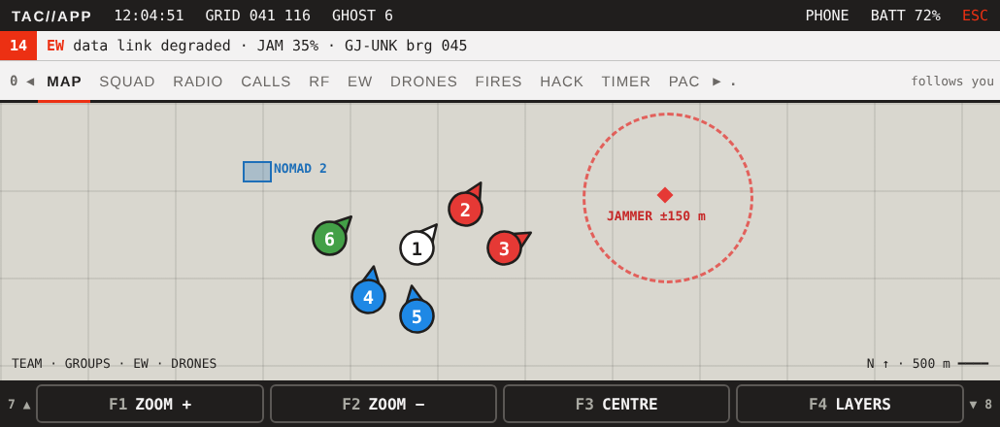

### SQUAD
Numbers and colours from `ghostD_bft_fnc_memberNumber` and ACE team colours, same as the BFT.

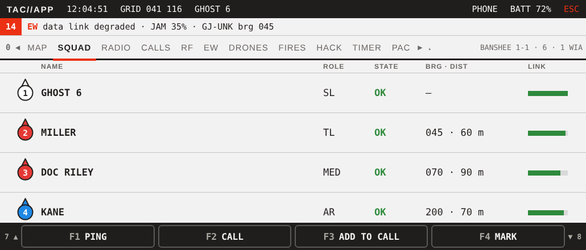

### RADIO
Only nets you are on. Ear tag pans beeps only (VON). F4 MANAGE is leaders, RTO and admin only.

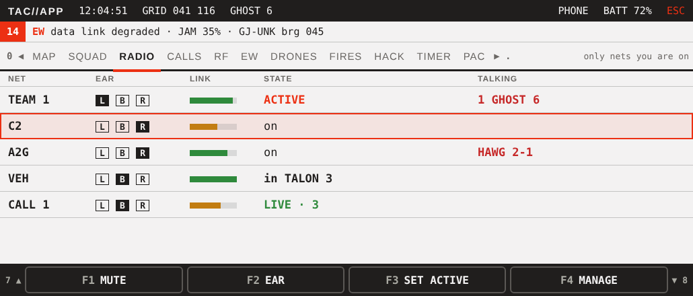

### CALLS
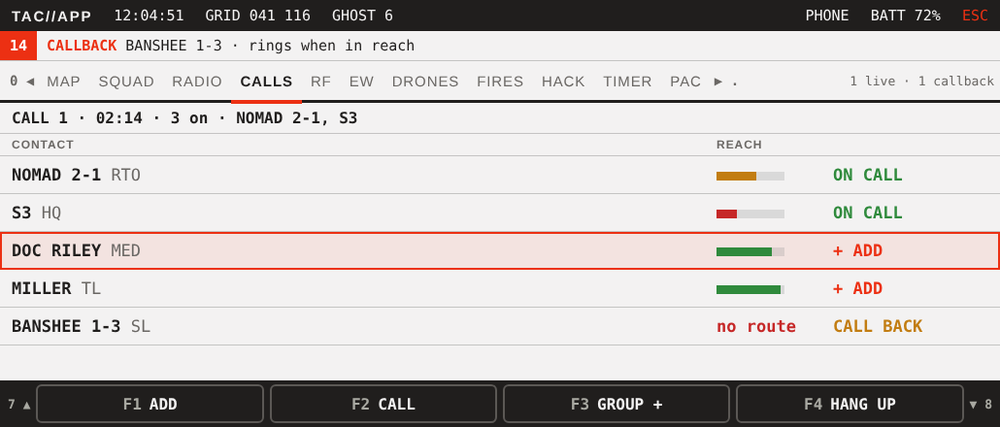

### RF
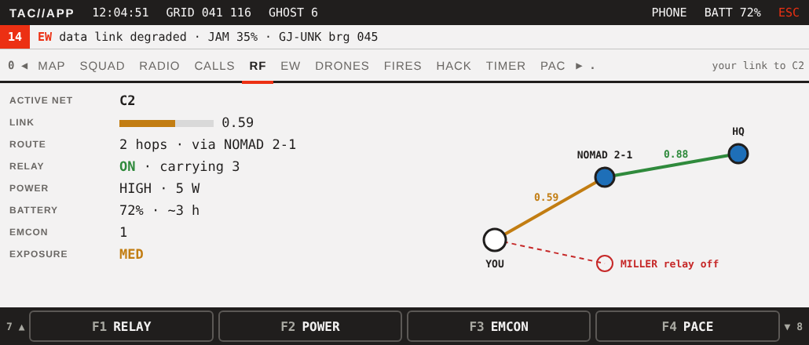

### EW
Needs `gfa_ew`. Without it the screen is left out of the strip.

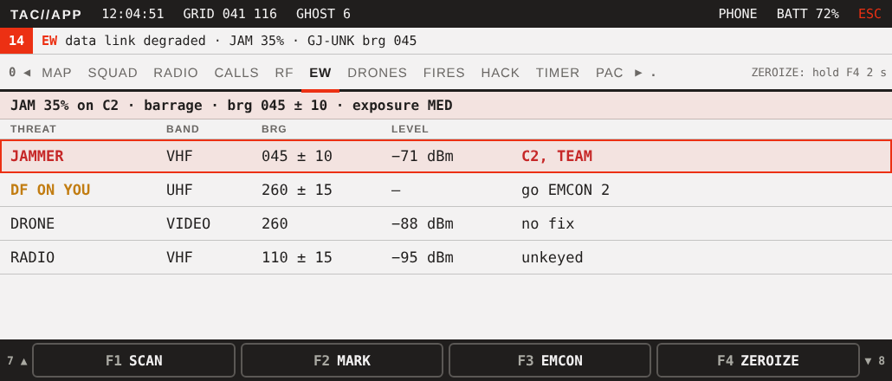

### DRONES
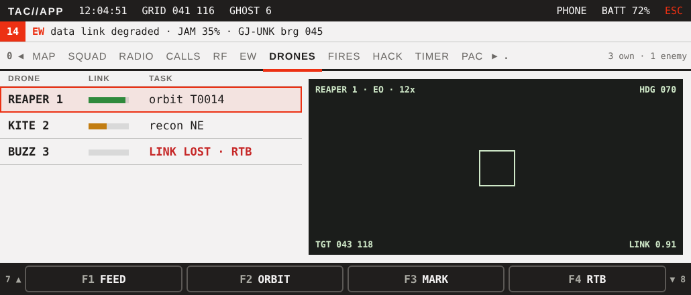

### FIRES
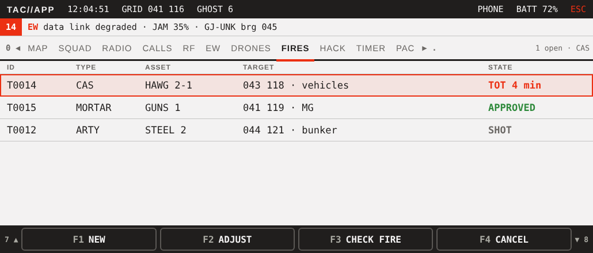

### HACK
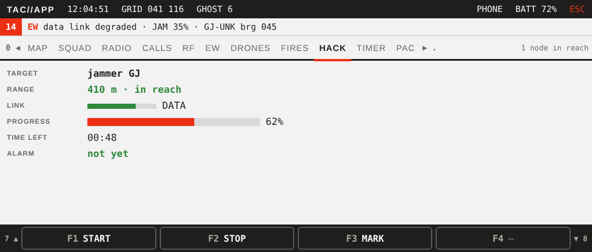

### TIMER
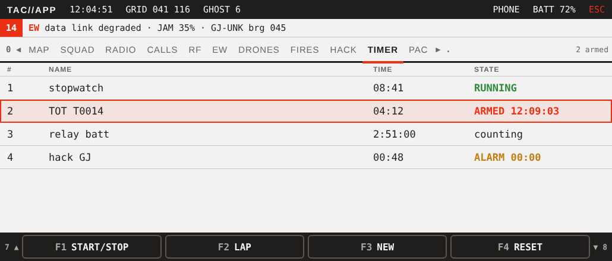

### PAC
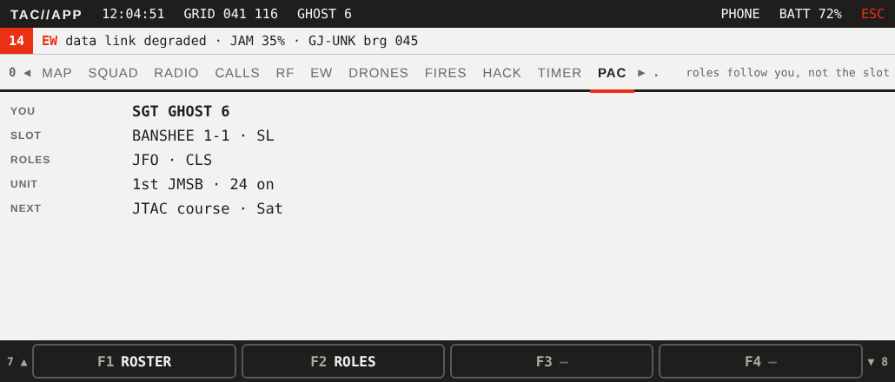

## Rules

- A screen whose mod is not loaded is left out of the strip (EW without `gfa_ew`, DRONES without uas, and so on).
- The strip remembers the last screen. The app reopens on it.
- RADIO opens on CALLS while a call is live or ringing (numpad 6 from the walking view).
- The notification line mirrors the popups; it does not replace them.

## Open

1. Cursor on 7 / 8. This replaces the earlier "7 / 8 = previous / next tab".
2. MANAGE: a screen of its own in the strip, or F4 on RADIO (as now)?
3. Add MEDIC (CLS / Medic only), INTEL, WEATHER, SETTINGS to the strip, or keep it short?
4. Which device uses which view: side devices portrait only?
5. Does the view type follow how the phone is held (an animation / pose), or only the SETTINGS choice?
