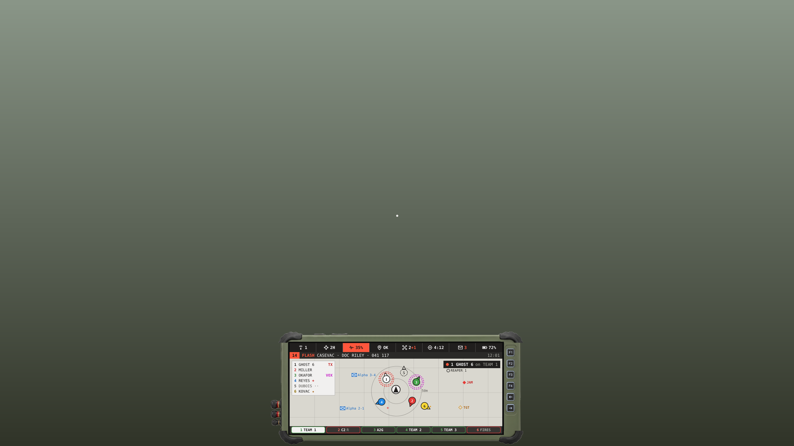
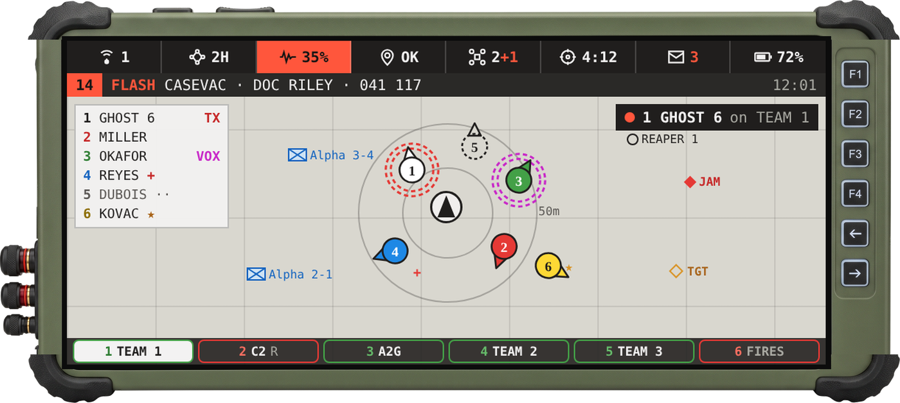
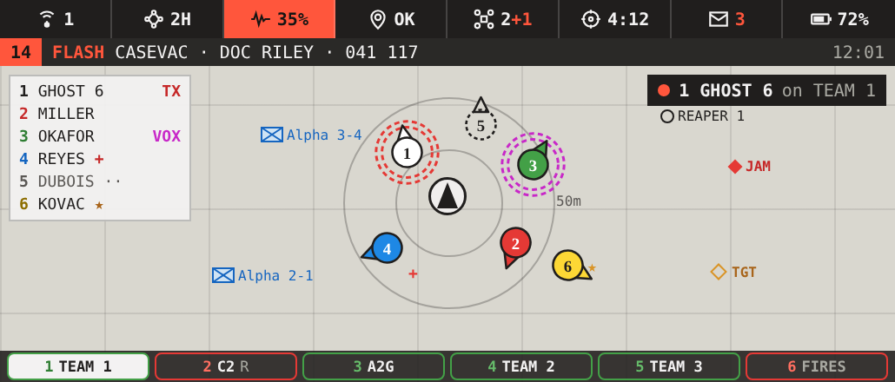

# Phone walking view - design

Device: phone (arsenal GPS slot). Spec: [SPEC_DEVICES.json](SPEC_DEVICES.json) `phone_ui`.
Status: design, for code. Date 2026-10-19.
Related: [DESIGN_BFT_MEMBERS.md](DESIGN_BFT_MEMBERS.md) (member icons), [DESIGN_SIDE_DEVICES.md](DESIGN_SIDE_DEVICES.md) (same content, portrait).

## What it is

The phone's always-on view. Display only, no mouse. Shown while walking around, toggled by a key. Replaces the DUI squad radar and the voice system's on-screen info. Fullscreen only for settings (separate doc).

## Images

In game, 1080p:

On the device:

Screen only (2x design units):

Canvas: TAC//APP Phone (artifact 5gFo1QBBxnchSCmcXKofWw).

## Size and placement

| | 1080p px | Notes |
|---|---|---|
| Frame | 610 x 274 | bottom centre, 4 px off the bottom |
| Screen | 515 x 220 | inside the frame, offset 45, 28 |
| Design units | 1030 x 440 | all sizes below are 2x; halve for 1080p |

- Use `safeZone` / `pixelGrid` so it holds size at other resolutions and UI scales.
- Frame texture: `phone_wide_cut.png` (2313 x 1037, glass cut out). Glass rect in the texture: 171,105 - 2124,938. Screen draws under the frame.
- Frame was widened by repeating its middle band. Never stretch it.
- CBA setting for position: centre (default) / left / right. Opacity setting 0.4 - 1.

## Layout (top to bottom, 2x units)

Changed 2026-10-21 (user, on the annotated drawing): the status row "seems kind of meaningless just taking up space" and the notification line was already meant to be gone from the phones and sides - both removed; the map takes their room.

| Row | Height | Content |
|---|---|---|
| Status row | 44 | 6 cells (2 rows of 3 on a side device): NET % free, MESH, JAM, GPS grid, DRONES, MSG - "the old top bar", back 2026-10-21; FIRES and BATT dropped (placeholders) |
| Map | the rest | centred on player, overlays on top |
| Net row | 36 | one cell per net |

The content sits 18 units inside the screen hole with a thin rim round it (the tablet's screen border, carried to every device), clear of the frame's corner bumpers.

### Over the map

- **NET %** (status row): game voice's ten custom channels still FREE - "no net number", "reverse the % to available" (2026-10-21); amber at 20% or less, red at none.
- **Grid** (the GPS cell of the status row, 2026-10-21): the grid square you are in, 8 or 10 figures by the player's CBA setting **Device grid digits** (`jmfsb_devices_gridDigits`). From the device's GPS: NO FIX in red while denied, amber + SUSPECT, the spoofed grid when spoofed. The tablet bar shows the same (`fnc_deviceFacts`).
- **Call strip**, along the map's bottom, only while there is call business (ring, live call, callback, F2 quick add, a call's last word). Notifications pop up top right on the game screen only.

### Map

- A map control inside the display. Re-centred on the player every frame; north up.
- Zoomed in so ~50 m radius fits the height. Rings at 25 m and 50 m, labelled.
- Player: large icon, centre, dark pointer = facing.
- Squad: BFT member icons from [DESIGN_BFT_MEMBERS.md](DESIGN_BFT_MEMBERS.md). Hook the same `ghostD_bft_fnc_drawMembers` on this map control's Draw event. Do not write a second draw.
- Extra marks next to a member: red `+` wounded, `★` buddy. Dashed icon = no link to him.
- Other groups: the BFT's NATO marker + callsign, small, not numbered.
- Other small icons: drones (circle + callsign), jammers (red diamond `JAM`), targets (orange diamond `TGT`).
- No compass tape.

### Map overlays

- **Squad list**, top left, 210 wide: `<N> <NAME>` per member, number in team colour, from `ghostD_bft_fnc_memberNumber`. Right side flags: `TX` red (radio), `VOX` magenta (direct voice), `+` wounded, `··` no link, `★` buddy.
- **Who is talking**, top right: dark chip, red dot, `<N> <NAME> on <NET>`. Shows the last speaker for a few seconds.

### Net row

- One square cell per net the player can use, equal width, 28 high, 3 px outline.
- Text `<N> <NAME>`: number + name, 12 chars max (name 10). N is the **Select net N** key: numpad 1-4 for nets 1-4 by default, 5-9 unbound (numpad 5-9 are the tablet, RADIO, tabs and TIC); all CBA keybinds.
- Outline is the net's state (2026-10-21, `jmfsb_voice_fnc_netQuality`): green good, amber weak or jammed, red no route, dim muted.
- Active net: light fill, dark text.
- Small grey `R` = receive only.
- Only nets you are on are shown: VEH appears in a vehicle, CALL when a call is live or ringing. Cells show name + ear tag (L/B/R), no numbers.
- Numpad 0 / . move the active net left / right. **Ctrl +** numpad 1-4 are the device keys F1-F4 (F1 accept call, F2 ear / quick add, F3 mute, F4 decline / hang up), changed 2026-10-21 so plain 1-4 select nets. See [DESIGN_VOICE.md](DESIGN_VOICE.md). Frequencies never shown.

## Colours

| Use | Hex |
|---|---|
| Bars | `#201e1d`, notification `#2a2927` |
| Map ground | `#d9d7cf`, grid `rgba(32,30,29,0.1)` |
| Alert | `#ff563c` |
| OK outline | `#43a047` |
| Problem outline | `#e53935` |
| Text light / dim | `#f3f2f2` / `#a9a9a2` |
| Team colours | per DESIGN_BFT_MEMBERS |

Font: IBM Plex Mono in the mockup. In game use the closest Arma font (`EtelkaMonospacePro` or `RobotoCondensed`); check legibility at 1080p - text is 9-10 px tall.

## Behaviour

- Toggle key (CBA keybind) shows/hides. State saved per profile.
- Hidden while in the map screen, in a vehicle with the vehicle tablet open, in the arsenal, dead, or in spectator.
- Only shown when the phone is in the GPS slot. Vanilla GPS minimap is not touched.
- Refresh: map every frame; rows 2 Hz; squad list 1 Hz.

## Build notes

- `RscTitles` display via `cutRsc` so it never takes input.
- Controls: frame picture, 2 bars as structured text, map control, list structured text, net row as N structured text cells.
- Map control in a title display: test that `ctrlMapAnimAdd` centring and Draw EH work there (cTab-style).

## Not in scope

- Notification log, settings fullscreen, apps.
- Side devices (own doc).
