# Voice (game VoIP) - design

Voice runs on Arma 3's own VON. RF decides who hears whom; VON carries the audio.
Related: [DESIGN_RF.md](DESIGN_RF.md), [DESIGN_EW.md](DESIGN_EW.md), [DESIGN_TABLET_APPS.md](DESIGN_TABLET_APPS.md).
Canvas: TAC//APP Voice (artifact TkPxnzSsb5PBfguWuEbRQc).
Status: design, for code. Date 2026-10-20.

## Decision

- **Base voice is VON.** Nothing to install, nothing to host, no DLL.
- **VON only without TFAR or ACRE; TFAR and ACRE stay supported** (user, 2026-10-20: "our in game VoIP setup should only run if there is no TFAR or ACRE", then "keep the ACRE and TFAR"). Which one carries the voice is read once from the loaded mods (`jmfsb_voice_system` `"von"` / `"tfar"` / `"acre"`; `jmfsb_voice_active` = VON is running). With TFAR or ACRE nothing of VON is set up - no channels, PTT, VON block, volume, calls or our sounds - and the voice core runs in external-radio mode: that radio's adapter serves the nets, the active net, ear / mute where the radio has them, quality and who is talking, so every screen still reads one API. Calls are VON only.
- **One voice adapter interface:** `join(unit, net)`, `leave(unit, net)`, `quality(unit, net, q)`, `talking(unit, net)`.
  - VON is the first adapter (`jmfsb_adapter_von`).
  - TFAR is the second (`jmfsb_adapter_tfar`, optional, loads only with TFAR): its radios' channels are the nets (frequencies from the PAC net plan), TFAR's own stereo and volume are the ear and mute, RF quality drives TFAR's range, and each speaker pushes his key to his side for the talking indicators.
  - ACRE is the third (`jmfsb_adapter_acre`, optional, loads only with ACRE): its radios' channels are the nets (the PAC plan's ACRE channel labels), ACRE's spatial zone and volume are the ear and mute, its speaking events are who talks, and quality is left to ACRE's own signal model.
  - An external radio's adapter has no join / leave (the radio's channels are its membership) and answers `nets`, `netState`, `talking` instead (addons/voice/README.md).
  - Enfusion VoN is the Arma 4 adapter.
- **Radio items stay plain** so VON needs no mod: the MPU5, TW-950 and radio bags become TFAR sets only through the optional patch `jmfsb_compatibility_tfar_radios`.
- **What carries over unchanged:** the RF mod, the UI and the rules.
- **Not used:** LiveKit (it was only for an external voice app).
- **Spec:** `SPEC_TACNET.json` D14 (replaces D1 / D1b), D16 (numpad), `voice_adapter`.

## VON vs TFAR standalone

| | VON + our layer | TFAR standalone + override |
|---|---|---|
| Install / hosting | none | mod with a DLL, plus a voice relay server |
| Nets | 10 custom channels + Group | effectively unlimited |
| Calls at once | about 8 | no practical limit |
| Ear split per net | beeps only (panned) | yes, voice too |
| Volume per net | no, per speaker | yes |
| Link quality | volume fade + static overlay | real degradation |
| Direct voice 3D | yes, fixed range | yes, 3 ranges |
| Carries to Arma 4 | the concept does | no |
| Risk | low | medium |

## Channels

| ID | VON channel | Our use | State |
|---|---|---|---|
| 0 | Global | admin broadcast | talk: admins only |
| 1 | Side | not used | disabled |
| 2 | Command | not used (C2 replaces it) | disabled |
| 3 | Group | TEAM net (one per Arma group) | on, mesh sets volume |
| 4 | Vehicle | crew intercom | on, no mesh, works inside the vehicle only |
| 5 | Direct | local voice, 3D | on, untouched, cannot be jammed |
| 6 | Custom 1 | C2 | membership from fill and keys, mesh sets volume |
| 7 | Custom 2 | A2G | pilots and copilots by seat, plus the ground squads the plan lists; mesh sets volume |
| 8-15 | Custom 3-10 | CALL 1-8 | made on dial, removed on hang-up, mesh sets volume |

- **Side** reaches every player on your side, anywhere, with no range, so it would bypass the mesh, jamming and keys. That's why it is off.
- **Commands used:**
  - `radioChannelCreate`, `radioChannelAdd` and `radioChannelRemove`: make channels and set who is in them.
  - `setCurrentChannel`: which channel you talk on.
  - `enableChannel`: block talking on a channel.
  - `getPlayerChannel`: who is talking, and on which channel.
  - `setPlayerVoNVolume`: per-listener volume for each speaker.
  - Server: `disableChannels`, plus the VON codec settings.

## Numpad

| Numpad | Does |
|---|---|
| Ctrl + 1 2 3 4 | device keys F1 F2 F3 F4 (2026-10-21) |
| 1 2 3 4 | select net 1-4 - the number on the net chip (5-9: keybinds, unbound by default) |
| 0 / . | device arrows: active net left / right (walking view), cursor (apps) |
| 5 | open / close tablet |
| 6 | open / close RADIO app on your phone or side device (proposed) |
| 7 / 8 | previous / next tab in the small-device apps (proposed) |
| 9 | TROOPS IN CONTACT |

**F-keys on the walking view:**
- **F1:** accept a call.
- **F2:** ear for the active net; during a call, quick add.
- **F3:** mute the active net.
- **F4:** decline or hang up.

## Mesh drives VON

- **Every tick (1 s)** the RF mod works out each listener's quality to each speaker on each net (widest path, see the RF doc).
- **The listener's client sets that speaker's volume** (`setPlayerVoNVolume`): 1 = full, falling = quieter with static, 0 = muted.
- **Membership changes only for keys, fills, calls and pilot seats.** A flickering link changes volume; it never kicks anyone out of a channel.
- **Islands:** a squad cut off from C2 still hears each other on C2, and loses everyone beyond the gap.
- **Group channel:** team nets can't have people removed, so they are muted by volume instead.
- **Grace time:** 3 s before muting a speaker whose route drops (proposed).
- **The speaker pushes his key** (2026-10-20): on his push-to-talk down and up he sends one event per edge, `[speaker, net, on]`, to everyone who can hear him on that net's channel (Group: his Arma group; Vehicle: everyone aboard; a custom channel: everyone on a net that rides it). Each listener's client sets his volume at once from its current quality (`setPlayerVoNVolume` is the listener's own), shows him talking and plays the squelch and static. The per-frame `getPlayerChannel` check stays only as the fallback for a key-down that did not arrive.
- **Every PTT input counts:** Push To Talk, the VON toggle and the per-channel keys (All, Side, Command, Group, Vehicle, Direct), read with `inputAction` every frame. A per-channel key transmits on that channel, so the transmission is the net mapped to it; Direct stays untouched.
- **The VON toggle is blocked** (the mission display swallows its key, and the player is told once to bind Push To Talk under Configure > Controls > Multiplayer). At mission start he is warned when Push To Talk has no key or his VON volume is near zero.
- **Cut-offs:** no radio (our nets, Group, Vehicle and the custom channels) while dead, unconscious (lifeState `INCAPACITATED`, which covers ACE) or unable to breathe (underwater without a rebreather); Direct closes only when dead or out of air. Radio silence (EMCON 3) closes the radio nets only. A blocked key-down plays the blocked tone with a short reason; the channels come back as they were when the condition ends, including after respawn.
- **Stands down under TFAR or ACRE** (user, 2026-10-20): with either loaded, none of this runs (`jmfsb_voice_active` false); the voice API then serves that radio's nets (see Decision).
- **Base stations; the manpack is optional** (user, 2026-10-20: "can we lose the LR or use our patrol base as a relay", "a staging zone or patrol base as a sat uplink"). Every staging zone and every built patrol base carries a base station (RF profile `base`, `jmfsb_pac_fnc_baseStation`; a setting each to turn them off). It relays the side's nets locally round the site, like a ground relay, and uplinks by satellite to every other base station (and SAT-capable vehicle) under open sky, at any distance, in one hop. Every set carries the C2-kind net, so a squad on handhelds that meshes into a patrol base talks on C2 to the staging zone and every other base. Nothing needs an LR manpack for C2; a manpack is optional kit that extends range away from the bases. See DESIGN_RF.md "Base stations".

## A2G is pilots

Decided (user, 2026-10-20: "who counts as air: pilots").
- **Air joins by seat.** The driver of an Air vehicle (not a parachute) and anyone in one of its copilot turrets (the turret's config `isCopilot`) join an A2G net by themselves, and leave it when they leave the seat. Drone operators and door gunners are not air.
- **Which A2G net:** the a2g net of the signal plan that lists the pilot's squad, else the plan's first a2g net, else the default A2G.
- **The ground stays as the plan lists it:** squads in the plan's a2g row are on that net. With no a2g net in the plan at all (no PAC plan, or a plan without an a2g row) the default plan puts everyone on A2G, as before; a plan that has a2g nets but does not name a squad leaves that squad off A2G.
- **Seat changes only.** The seat is read on GetInMan, GetOutMan, SeatSwitchedMan, Killed and Respawn (and once at mission start), never per frame. The fill picks up the new net on its next tick.

## Nets on the devices

- **Only nets you are on are shown.**
  - VEH appears inside a vehicle.
  - CALL appears when a call is live or ringing.
  - A loaded or captured key shows its net while the key is held.
- **A net you're on but can't reach shows a red outline.** It is not hidden.
- **Ear tag per net** (L / B / R). VON can't pan voice, so the ear pans the net's beeps and static, not the voice.
- **Talking box:** name, net and ear.

Phone walking view, incoming call, in a call:

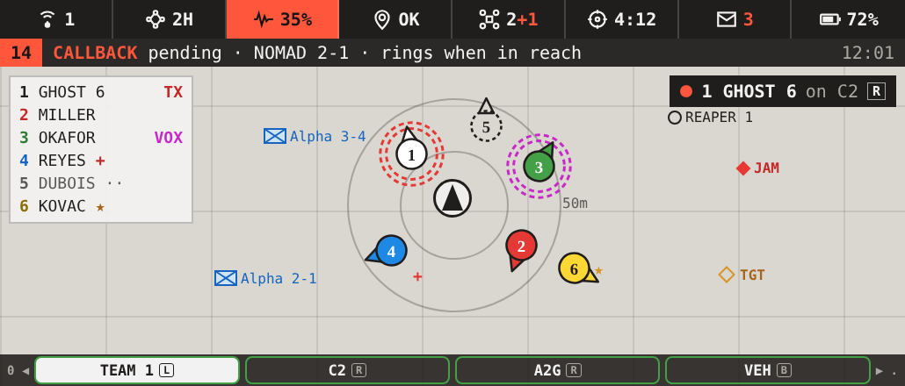
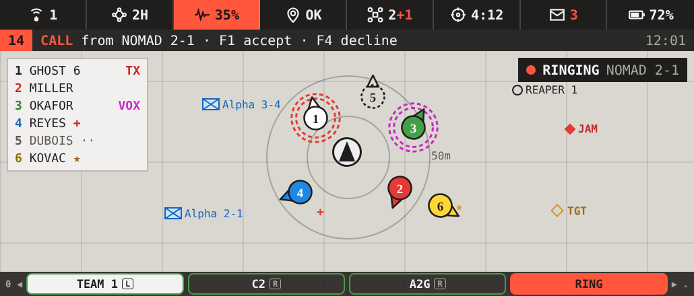
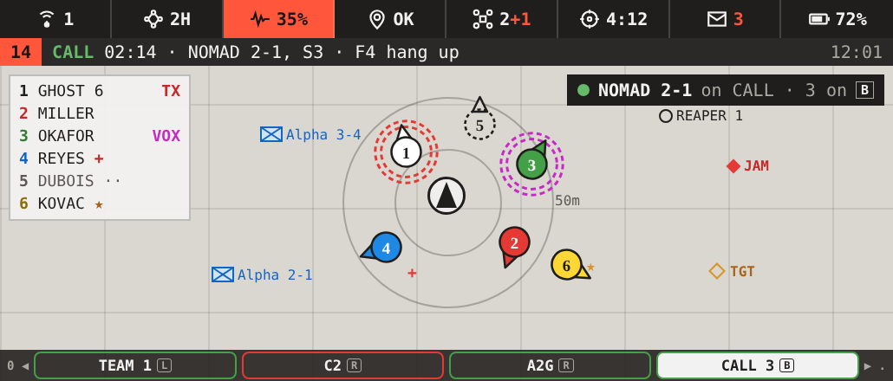

Side device walking and ringing:

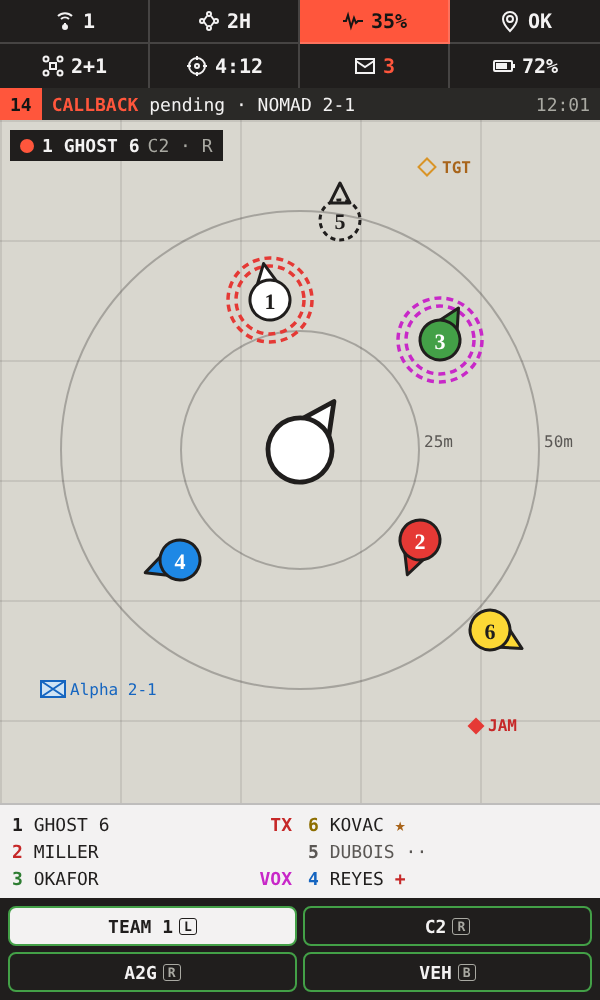 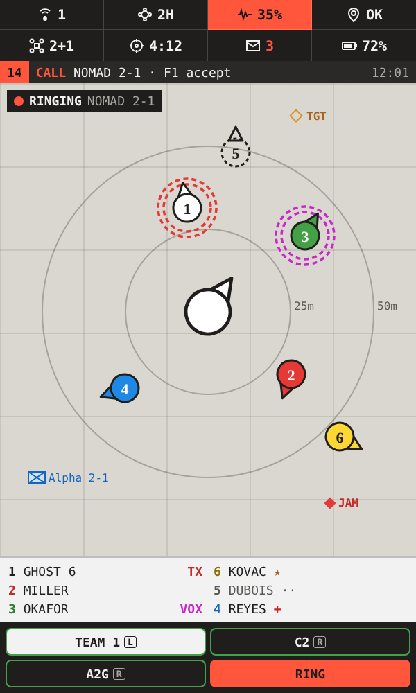

## Calls

- **A call is one custom channel,** any size up to 8 people. Max 8 calls at once.
- **Dial:** CALL needs reach on DATA. The other person gets a ring, with F1 accept and F4 decline.
- **Add people:**
  - + ADD on a contact while a call is live;
  - group buttons: + MY TEAM, + SQUAD LEADERS, + RTOs, + MEDICS, + HQ;
  - search by name or callsign;
  - the recent contacts list;
  - ADD TO CALL from a member on the map or the squad list;
  - F2 quick add on the walking view.

  Added people ring until they accept. Group adds skip people out of reach and stop at 8.
- **Leave / end:** anyone can hang up. The call ends when one person is left, and its channel is freed.
- **Priority:** a FLASH call from the RTO or an admin can bump the oldest ROUTINE call when all slots are full. The bumped call gets a warning tone first.
- **The call's owner invites** (user, 2026-10-20): the person who started the call is its owner, and only the owner adds people (+ ADD, group adds, recent, F2 quick add). Added people ring until they accept. If the owner leaves a call that goes on, the longest-standing member becomes owner. There is no RTO pull-in.

### Callback

- **Offered when a call fails:** no route, busy, or no answer in 20 s. Press CALL BACK.
- **The server holds the request.** When both people can reach each other on DATA and a call slot is free, both phones ring.
- **Limits:** a request expires after 15 min. One per pair, and up to 3 pending per player.
- **Waiting:** a request waits while either person is in a call, and is held (not dropped) while either is on EMCON 3.
- **Both people see the pending callback**, on the notification line and in CALLS.

### Voice messages

- VON audio can't be recorded from script, so there are no recorded voice notes on VON.
- **Instead:** the callback above. Typed notes are possible later.
- Real voice notes need our own DLL (phase 2, TFAR / own-DLL path only).

## Sounds

Played locally. The radio itself sounds like Arma's own radio: its squelch and noise files (`A3\Dubbing_Radio_F\sfx\`, shipped with the game, referenced by path, not copied). The net switch, blocked and call tones are our own generated files. TFAR's sounds stay under its own licence and are not used.

| Radio | Sound | When |
|---|---|---|
| TX chirp | game squelch in (`in2b.ogg`) | you start talking on a radio net |
| Roger beep | game squelch out (`out2b.ogg`) | you stop |
| Squelch open / tail | game squelch in / out (`in2a.ogg` / `out2a.ogg`) | someone you can hear starts / stops |
| Static | game radio noise (`radionoise1.ogg`) | under their voice, louder as quality drops |
| Cut | game squelch out (`out2c.ogg`) | the speaker's route drops mid-transmission |
| Net switch click | ours | you change active net |
| Blocked tone | ours | you try to talk with no route or no set, on EMCON 3, jammed, or cut off (dead, unconscious, no air) |

| Call (all ours) | When |
|---|---|
| Dial tone, ringback | you start a call |
| Ring | incoming call or callback |
| Busy | no free slot, or the other person is busy |
| Connect / hang-up | call opens / ends or someone leaves |
| Join chime | someone is added |
| Priority warning | your ROUTINE call is about to be bumped |

- **Pitch per net:** C2 low, TEAM mid, A2G high, CALL two-tone, so you know the net before the voice starts.
- **Ear:** beeps and static play from the net's ear.
- **Settings:** radio beeps on/off, call beeps on/off, one beep volume, pitch per net, static by quality.
- **Triggers:**
  - Your own transmissions: our push-to-talk handler (every PTT input, by `inputAction`).
  - Other speakers: the key event each speaker pushes on his own key-down / key-up (Mesh drives VON). VON has no talking event; a per-frame `getPlayerChannel` check is only the fallback.
  - Mesh: radio sounds only play for speakers you can hear by mesh volume.
- **Static** is the game's 5.7 s noise clip, started under the voice, started again just before it ends or when quality changes, and stopped when the speaker stops.

## Tablet RADIO app

**NETS:** your nets, VON channel, link, ear (L/B/R), beep volume, state, who is talking; sounds and keys panels.

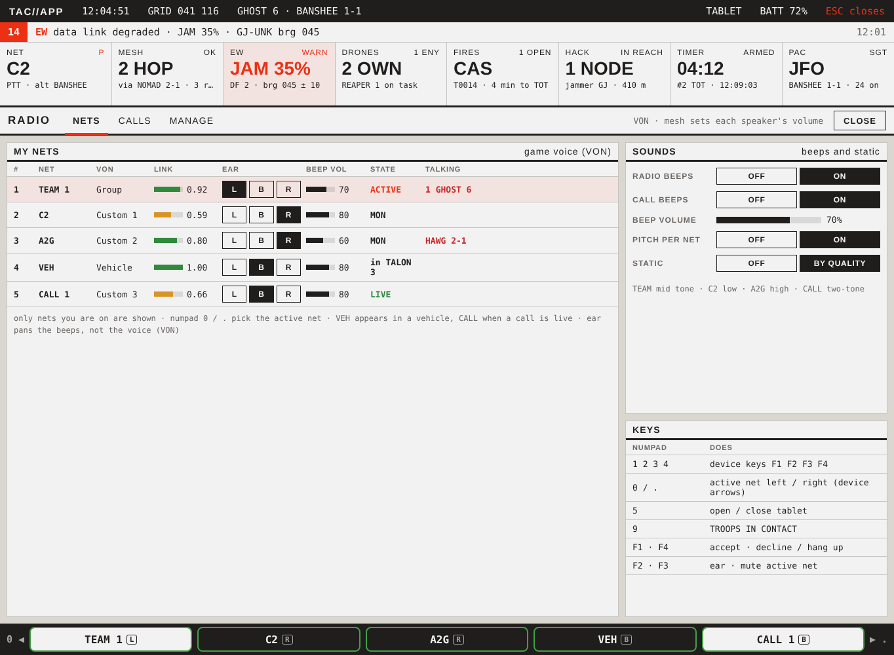

**CALLS:** VON channel slots (server-wide), contacts with + ADD / CALL / CALL BACK, group adds, search, the live call with recent contacts, and pending callbacks.

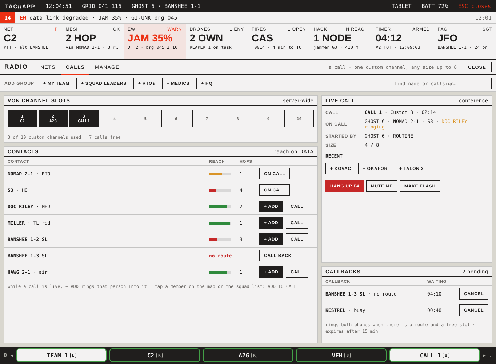

**MANAGE:** leaders, RTO and admin only.

**The RTO console is a player job** (user, 2026-10-20), not admins only: the console features below and the RTO column of the table belong to whoever holds the RTO role. One test says who that is (`jmfsb_voice_fnc_isRto`), used by the tablet and phone MANAGE tabs, the CALLS FLASH right and the voice API (`canFlash`). He is the RTO when any of these holds:
- the `isRTO` flag on him: a PAC skill effect (`trait:isRTO` or `var:isRTO=true`, his own skills or his role's granted skills) or the mission's own `setVariable`;
- an RTO skill tag from PAC (`jmfsb_pac_skillTags`);
- his slot's role description names a radio job (whole words RTO, RADIO, JTAC, FAC).

Wearing a manpack no longer makes a man the RTO (user, 2026-10-20: "can we lose the LR"): the job comes from PAC or the slot only.

The MANAGE actions below are not built yet, apart from the RTO nets (after the table): the voice API has no call for them, so the tab shows them as NOT BUILT rather than as dead buttons.
- **Nets:** VON channel, members, key, PACE alternate, state.
- **Temp nets:** built as the RTO nets - each takes a custom channel and keeps it for the mission.
- **Patches** through a gateway (no slot).
- **Members:** route, hops, listen-only; ADD / REMOVE / REKEY / FORCE PACE / ORDER EMCON.
- **Signal plan:** load, reset (RTO); export to the mission config (admin).

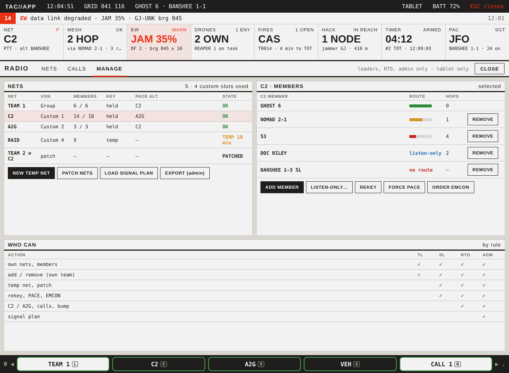

| Action | TL | SL | RTO | Admin |
|---|---|---|---|---|
| own nets, members | ✓ | ✓ | ✓ | ✓ |
| add / remove (own team) | ✓ | ✓ | ✓ | ✓ |
| custom nets | | | ✓ | ✓ |
| rekey, PACE, EMCON | | ✓ | ✓ | ✓ |
| C2 / A2G, calls, bump | | | ✓ | ✓ |
| signal plan load, reset | | | ✓ | ✓ |
| signal plan export | | | | ✓ |

**RTO nets** (user, 2026-10-22: "add an rto skill or trait, and on the radio app allow rtos to add custom channels"): the RTO makes nets of his own from the MANAGE tab, and they behave like any other net - a chip on the net row, the walking view and NETS, in the numpad cycle, keyed by push-to-talk, meshed on VHF like TEAM.
- **Who:** the RTO (`jmfsb_voice_fnc_isRto`; the PAC skill `rto`, written by `tools/pac_skill_rto.py`) or a logged-in admin. The tablet shows the block by `jmfsb_voice_fnc_canManageNets` (RTO, or `jmfsb_common_isAdmin`); the server re-checks every request with `canFlash`, the FLASH right, and answers a refusal on the caller's notify line the way a refused call is shown (`notRto`, `badName`, `taken`, `full`, `noChannel`, `unknown`).
- **The net:** its id is its name, upper-cased and trimmed - 2 to 10 letters, digits, spaces and dashes; not a plan net's name, not C2 / A2G / VEH / DIRECT / GLOBAL / DATA, not `TEAM ...` or `CALL ...`. Members are squads (callsigns) and players (uids), and the RTO can replace both lists later. Kind `custom`, band VHF as TEAM, no plan slot.
- **Server state:** `jmfsb_voice_customNets`, id -> [name, squads, uids, owner uid, owner name], published as `jmfsb_voice_customPub` (`[[id, name, squads, uids, ownerUid, ownerName], ...]`) only when it changes and kept for JIP like the roster. Each client's plan refresh appends one row per published net and raises `jmfsb_voice_netsChanged` as it does for the PAC plan; `fill` and `nets` list them after A2G and before the calls; a removed net leaves everyone's plan the next second.
- **VON channel:** one per net, reserved on create through the adapter's `reserve` hook (keyed by the net id, its own colour). VON cannot delete a custom channel, so a removed net's channel stays cached by key and is reused when the same name is made again. Each takes one of VON's ten custom channels for the rest of the mission and the calls get what is left: `jmfsb_voice_customNetsMax` ("RTO nets at once", 0-6, default 2, server-forced) caps them, and the phone's NET % drops by one per net.
- **API:** `jmfsb_voice_fnc_netAdd [name, squads, uids]`, `netRemove [id]`, `netMembers [id, squads, uids]` (bool: sent, not done - success shows through the publication), `customList`, `customNets [unit]`, `canManageNets [unit]`; server events `jmfsb_voice_srvNetAdd` / `srvNetRemove` / `srvNetMembers`, the refusal `jmfsb_voice_netFailed [reason]`.
- **Under TFAR / ACRE** the block is read-only, like the rest of the app.

## Phone and side RADIO app

- **Opens full screen** on the carried device (numpad 6, proposed). The mouse works too.
- **Cursor:** numpad 0 / . move it; F1-F4 are soft keys, shown along the bottom; 7 / 8 switch tabs (proposed).
- **Layout:** the phone uses wide tables. The side device stacks each row onto two lines, with the soft keys in a 2 x 2 grid.

| Tab | F1 | F2 | F3 | F4 |
|---|---|---|---|---|
| NETS | MUTE | EAR | SET ACTIVE | BACK |
| CALLS | ADD | CALL | GROUP + | HANG UP |
| MANAGE | ADD | REMOVE | REKEY | BACK |

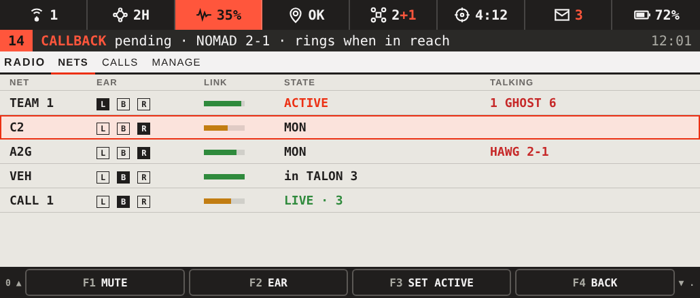
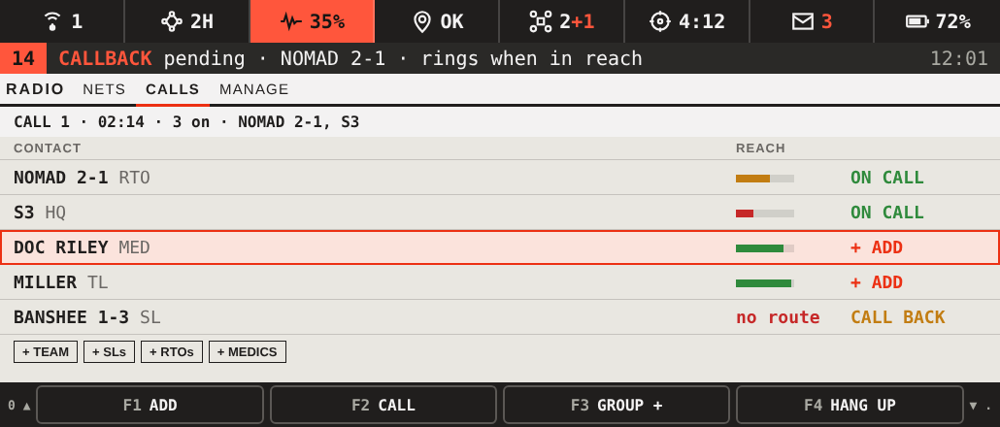
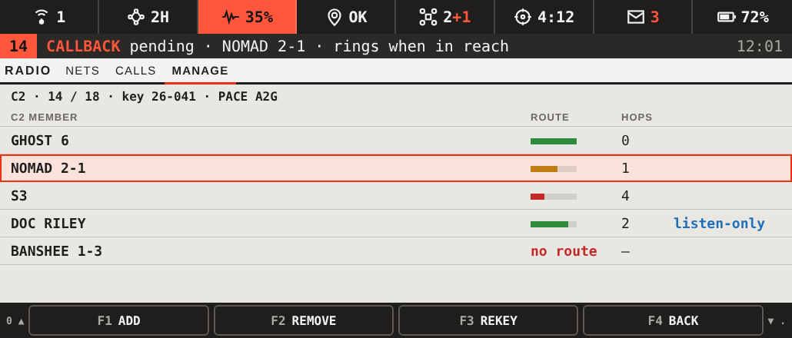

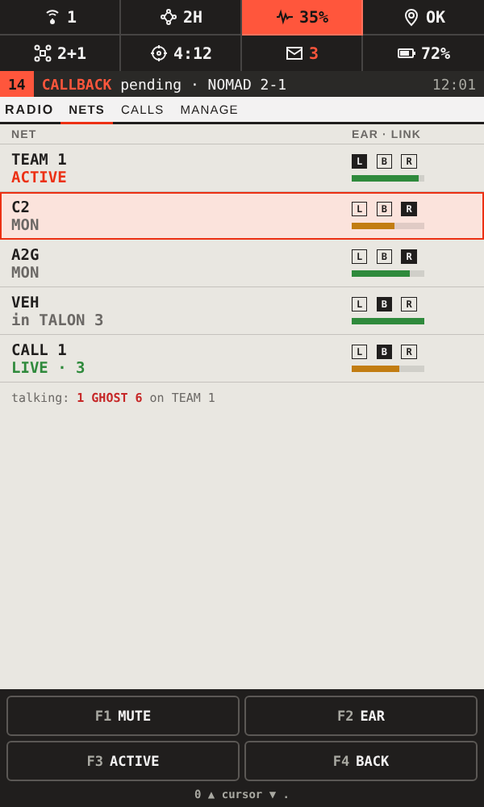 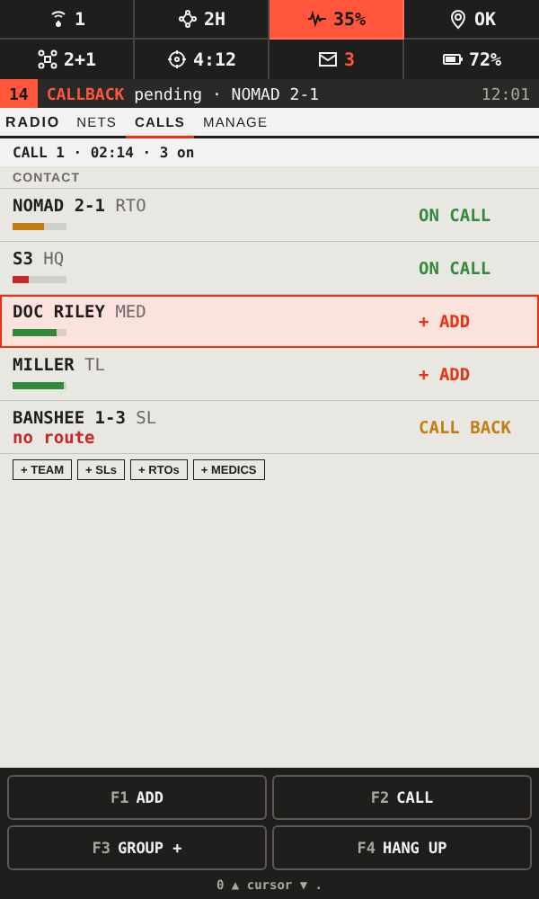 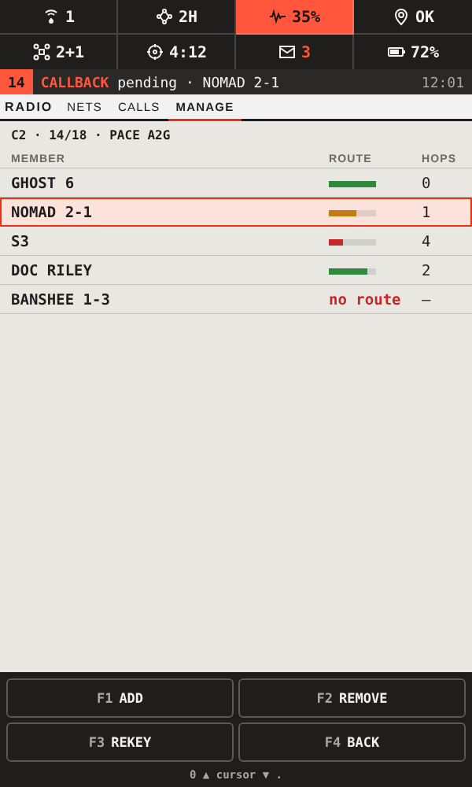

**Adding a caller on the phone or side device:**
1. Open RADIO. It opens on CALLS while a call is live.
2. Move to the person with 0 / .
3. Press F1 ADD.

- **Group add:** F3 GROUP +, move to the group, F1.
- **Quick add from the walking view:** F2 during a call opens a recent / team list on the notification line. Move with 0 / . and press F1 to add; F4 closes it.

## Tests to run first

1. `setPlayerVoNVolume`: per listener, per speaker, across all channels.
2. `enableChannel` with voice off: you can still hear the channel (needed for listen-only).
3. `getPlayerChannel`: updates fast enough for speaking indicators and sounds.
4. Add / remove delay on custom channels across clients.
5. Whether script can limit the Vehicle channel to crew (otherwise passengers are muted by volume).

## Open

- **Mesh:**
  - Do handhelds relay by default?
  - Are the hop limits right (4 / 6 / 8)?
  - Should AI radios relay for players? Proposed: no.
  - Is a 3 s grace time right?
- **Keys:** confirm numpad 6 (radio app), 7 / 8 (tabs), and F2 quick add.
- **MANAGE on small devices:** leaders only, as on the tablet?
- **Group add:** ring everyone, or join them directly?
- **Callback:** ring both people at once, or B first?
