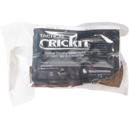

# ACM CBRN Guide

## Agents

Four chemical agents are modelled. Three of them kill.

| Agent | Type | Looks like | Delivered by | Absorbed through |
| --- | --- | --- | --- | --- |
| CS | Tear agent | Faint grey gas | CS grenades, 40mm CS shells, mortars | Lungs, eyes |
| Chlorine | Pulmonary agent | Bright yellow gas | Mortars, chemical IEDs | Lungs, skin |
| Sarin | Nerve agent | Colorless gas | Mortars, chemical IEDs | Lungs, skin |
| Lewisite | Blister agent | Colorless gas | Mortars, chemical IEDs | Not stated on the wiki |

| Agent | Immediate | Moderate | Prolonged |
| --- | --- | --- | --- |
| CS | Coughing, pain | Blindness | Difficulty breathing |
| Chlorine | Coughing, pain, choking | Airway inflammation, blindness | Unconsciousness, respiratory arrest, death |
| Sarin | Coughing, pain | Muscle spasms | Unconsciousness, airway spasm, respiratory arrest, death |
| Lewisite | Coughing, pain, chemical burns | Blindness | Unconsciousness, airway inflammation, respiratory arrest, shock, death |

Sarin and lewisite are colorless. The first sign is coughing and pain with no visible gas.

## Protection

A gas mask stops inhalation and a CBRN suit stops skin absorption.

| Agent | Gas mask | CBRN suit |
| --- | --- | --- |
| CS | Stops all effects | Not needed |
| Chlorine | Stops inhalation | Stops skin exposure |
| Sarin | Stops inhalation | Stops skin exposure |
| Lewisite | Stops inhalation | Stops skin exposure |

- Filters get used up while exposed. Replace them.
- Vanilla masks and suits count by default. Modded ones must be added in the ACM settings.

Vehicles:

| Type | Examples | Protection |
| --- | --- | --- |
| Overpressured | CBRN vehicles, some IFVs and tanks | Full. Agents cannot get in |
| Sealed | Some MRAPs, APCs, IFVs, tanks | Only while shut. Opening a door, turning out or dismounting ends it, and the cabin can be contaminated |
| Unprotected | Open-top, bikes, civilian | None |

Which vehicles are sealed or overpressured is set in the ACM settings.

## Self aid and buddy aid

Mask up, suit up, get out of the gas, then check your buddy.

Self aid:

1. Put on the gas mask. Put on the CBRN suit if the gas is yellow or you cannot see any.
2. Move out of the gas.
3. Swap the filter if you were in it for long.
4. Blinded: wash your eyes with water.
5. In pain: paracetamol.

Buddy aid:

1. Mask your buddy if they have not done it.
2. Drag them out of the gas.
3. Blinded: wash their eyes with water.
4. Unconscious: run the 3 Bs. Bleeding, breathing, beating.
5. Call CLS for muscle spasms, choking, chemical burns or anyone unconscious.

Muscle spasms mean nerve agent. Only the antidote stops it, and CLS carries it.

## CLS

CLS carries the nerve agent autoinjectors and keeps the airway open until the Medic arrives.

| Agent | CLS action |
| --- | --- |
| CS | Painkiller. Wash eyes with water |
| Chlorine | Painkiller. Wash eyes with water. Call the Medic if breathing worsens |
| Sarin | 2 to 3 ATNA autoinjectors. Midazolam autoinjector for seizures. Call the Medic |
| Lewisite | Call the Medic. Shock needs fluids |

| Autoinjector | Dose | Onset | Lasts | Effect on vitals |
| --- | --- | --- | --- | --- |
| ATNA | 2 to 3 injections to start | Under 15 s | About 15 min | Raises heart rate and blood pressure |
| Midazolam | 1 injection | Under 30 s | About 20 min | Lowers heart rate and blood pressure |

ATNA and midazolam autoinjectors:

 

- Run MARCH on every unconscious casualty once they are out of the gas.
- Severe airway inflammation and airway spasm both end in respiratory arrest. Only a surgical airway fixes them.
- An NPA or OPA may not go into an inflamed airway.

## Medic

The Medic gives atropine and fluids and cuts the surgical airway.

| Agent | Kills by | Medic action |
| --- | --- | --- |
| CS | Does not kill | Painkiller. Wash eyes |
| Chlorine | Airway inflammation, respiratory arrest | Painkiller. Wash eyes. Surgical airway for severe inflammation |
| Sarin | Airway spasm, respiratory arrest | Atropine 2 to 4 mg to start, more if needed, or 2 to 3 ATNA. Midazolam for seizures. Surgical airway for spasm |
| Lewisite | Airway inflammation, respiratory arrest, shock | Fluids for shock. Surgical airway for severe inflammation |

Atropine and CricKit:

 

- Atropine: IV or IM, 1 mg per 1 ml vial. Onset under 5 s IV, under 15 s IM. Lasts about 15 minutes. Raises heart rate.
- Airway spasm can make the BVM ineffective. Go to a surgical airway.
- A surgical airway needs a CricKit.
- The unit medication notes list dimercaprol 3 to 5 mg/kg IM for lewisite, never IV. The wiki overview does not list it. Confirm it exists in the current ACM build before issuing it.
