# ACM CLS Guide

## MARCH

Treat every casualty in MARCH order. Do not move to the next letter until the current one is controlled.

1. M, massive hemorrhage: stop the bleeding.
2. A, airway: open it and keep it open.
3. R, respiration: check the chest, seal it, decompress it.
4. C, circulation: pulse, CPR, AED.
5. H, head injury and hypothermia: consciousness, then pain and fractures.

Soldiers use the short form, the 3 Bs: Bleeding, Breathing, Beating. Related guides: [Drugs](drugs.md), [CBRN](cbrn.md), [MIST report](mist-report.md), [CASEVAC](casevac.md), [Evacuation](evacuation.md).

## Scope

CLS keeps the casualty alive with non-invasive tools and pre-dosed meds until a Medic arrives.

- You do: everything a soldier does, plus trauma dressings, NPA/OPA, suction bag, chest seal, needle decompression, pulse oximeter, AED in AED mode, autoinjectors and inhalers, SAM splint.
- You do not: IV or IO access, fluids or blood, vial medications, i-gel, surgical airway, thoracostomy, manual AED, fracture realignment, casualty conversion.
- Work in order: bleeding, airway, breathing, circulation, then fractures and pain.

## Kit

- Tourniquets, pressure bandages, emergency trauma dressings, elastic wraps
- NPA, OPA, emergency suction bags
- Chest seals, NCD kits
- Pulse oximeter, AED
- Paracetamol, Penthrox, naloxone spray, ammonia inhalant
- ATNA and midazolam autoinjectors when a chemical threat is briefed
- SAM splints

Quantities are not set yet.

## M: Massive hemorrhage

!!! USE TXA! | Bruising, or bleeding that will not stop, needs TXA. It is the Medic's vial: call for it the moment you see it.

Stop all external bleeding before anything else.

Tourniquet, emergency trauma dressing, elastic wrap:

 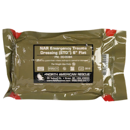 

1. Limb with many wounds: tourniquet.
2. Body part with many wounds: emergency trauma dressing. It is slower to apply and cannot be used on yourself.
3. Single wounds: pressure bandage.
4. Once stable: elastic wrap over bandaged and clotted wounds.

- Bruising on a body part with a falling blood pressure means internal bleeding. That needs TXA and fluids. Call the Medic.
- A long bleed uses up platelets. After that, wounds stop clotting and bleed faster.
- Tourniquets block IVs on that limb, and left on long enough the pain alone puts the casualty out. Take them off once the wounds under them are bandaged.

## A: Airway

Every unconscious casualty needs the airway held open, by hand or with an adjunct.

| Problem | Cause | CLS action |
| --- | --- | --- |
| Tongue blocks airway | Unconscious | NPA or OPA, head-tilt chin-lift, or recovery position |
| Mild obstruction | Vomit or blood | Head turn, or suction bag |
| Severe obstruction | Vomit or blood | Suction bag |
| Airway collapse | Unconscious for a long time | Head-tilt chin-lift or recovery position, and call the Medic for an i-gel |
| Inflammation or spasm | Chemical agent | Call the Medic. Needs a surgical airway |

NPA, OPA, suction bag:

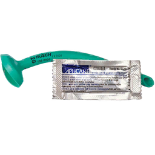 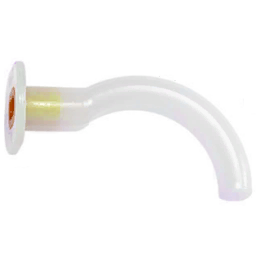 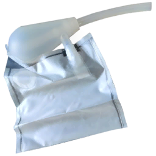

- NPA and OPA only go in when the airway is clear. Suction first.
- NPA and OPA do not manage collapse. Only hand maneuvers and the i-gel do.
- Head-tilt chin-lift is an active action. You hold it and do nothing else.
- The recovery position blocks most other treatment.
- A patient vomits a set number of times. Expect to suction more than once.

## R: Respiration

Seal every penetrating chest wound, then re-assess.

Check breathing (unconscious casualties):

| Result | Meaning |
| --- | --- |
| Not breathing | Airway blocked or collapsed, or respiratory or cardiac arrest |
| Shallow | Chest injury, or mild airway collapse |
| Slow or rapid | Respiratory rate under 16 or over 22 |
| Normal | Rate in range |

Inspect chest (casualty flat on back, airway clear):

| Result | Meaning |
| --- | --- |
| Rise and fall | Breathing, no chest injury |
| No movement | Not breathing. Check airway and pulse |
| Sides uneven | Pneumothorax |
| Tracheal deviation | Tension pneumothorax |
| Bruising on upper chest | Hemothorax |

Treatment:

1. Pneumothorax: chest seal. It stops the injury getting worse.
2. Tension pneumothorax: chest seal, then needle decompression with the NCD kit.
3. Hemothorax: chest seal and call the Medic. It needs TXA and a chest tube.

Chest seal, NCD kit, pulse oximeter:

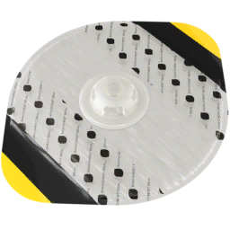 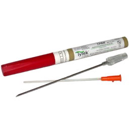 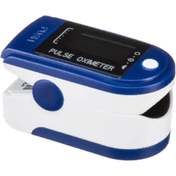

- A pneumothorax worsens for as long as the casualty breathes. Do not leave it.
- Pulse oximeter: under 80 unconscious, under 67 cardiac arrest, under 55 death.
- The reading is less reliable at low blood volume. With systolic under 90 it can be off by up to 30%.

## C: Circulation

No carotid pulse means cardiac arrest: connect the AED or start CPR at once.

| Check | Result | Action |
| --- | --- | --- |
| Carotid pulse (head) | None | Cardiac arrest drill |
| Radial or femoral pulse | Weak or none | Low blood volume. Call the Medic for fluids |
| Body parts | Bruising | Internal bleeding. Call the Medic for TXA |

Cardiac arrest drill:

1. Check for a cause you can fix: tension pneumothorax (seal and decompress), blocked airway (clear it).
2. If the casualty has had morphine or fentanyl, give naloxone now. Opioids more than double the time to get a pulse back.
3. Connect the AED and select AED mode. It analyzes, shocks when needed and tells you when to do CPR.
4. CPR for 2 minutes or until the AED prompts, then let it re-analyze. Repeat.
5. No AED: CPR for 2 minutes, carotid pulse check, repeat.

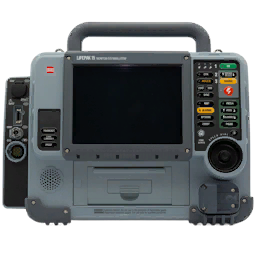

The full flow. The medication box is the Medic's part:

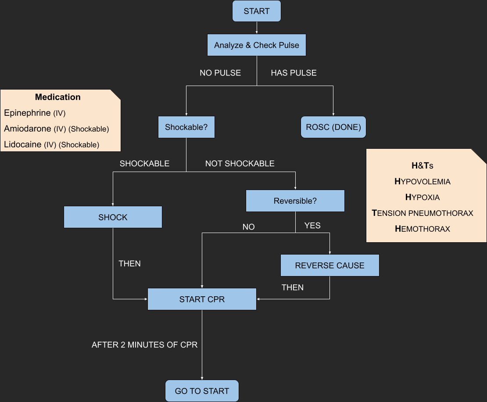

- Signs the pulse is back: cyanosis fades, carotid pulse returns.
- Arrest from blood loss will not resolve with CPR alone. It needs fluids from the Medic.
- Oxygen saturation falls during CPR even at full blood volume. The Medic carries the BVM.

## H: Head injury and hypothermia

The ACM wiki overview lists no head injury or hypothermia mechanics, so H is the consciousness check, then pain and fractures.

A casualty is out for one of four reasons, and stays out until it is fixed: pain past the threshold, low blood pressure, cardiac arrest, or saturation under 90. The game checks the vitals every 15 seconds.

- Unconscious with stable vitals: ammonia inhalant.
- Still unconscious: go back through M, A, R, C. Saturation under 80 keeps a casualty out; so does a tourniquet left on, or a limb that needs morphine.
- Conscious: manage pain, then fractures.

## Meds

CLS gives pre-dosed meds only: pills, inhalers, sprays and autoinjectors.

| Med | For | Dose | Onset | Lasts |
| --- | --- | --- | --- | --- |
| Paracetamol | Mild to moderate pain | 1 to 2 pills | Under 4 min | About 50 min |
| Penthrox inhaler | Moderate to severe pain, short term | 1 to 5 uses, 8 per inhaler | Under 3 s | About 4 min |
| Naloxone spray | Opioid overdose | 1 to 2 uses | Under 3 s | About 6 min |
| Ammonia inhalant | Waking an unconscious casualty with stable vitals | 1 use, 8 per inhalant | Under 3 s | Under 40 s |
| ATNA autoinjector | Nerve agent | 2 to 3 injections to start | Under 15 s | About 15 min |
| Midazolam autoinjector | Seizures from nerve agent | 1 injection | Under 30 s | About 20 min |

Paracetamol, Penthrox, naloxone, ammonia:

 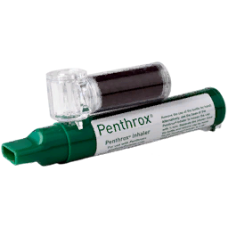 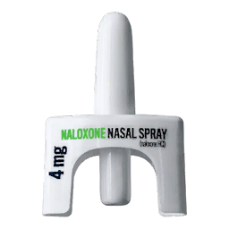 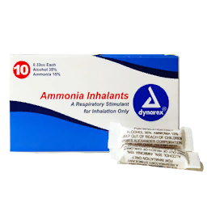

- Penthrox lowers heart rate. Do not use it on a casualty with a chest injury, slow breathing, low blood volume or altered mental status.
- Naloxone wears off in about 6 minutes. Opioids last longer. Watch the casualty and re-dose.
- Midazolam lowers heart rate and blood pressure.
- Morphine autoinjector is not issued. The unit medication notes treat it as unsafe.

## Fractures

Splint the limb so the casualty can move, and leave realignment to the Medic.

| Check for fracture | Meaning |
| --- | --- |
| No substantial damage | Undamaged |
| Limb is bruised | Bruised. Wrap it |
| Severe bruising | Mild fracture |
| Swelling | Severe fracture |
| Significant swelling | Complex fracture. Needs evacuation |

1. Apply a SAM splint.
2. Wrap the splint with an elastic wrap.

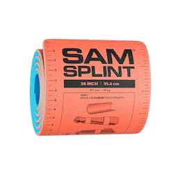

- A splint without realignment lets the casualty jog. Realignment plus splint restores sprint.
- Broken legs cause limping. Broken arms increase weapon sway.
- Fractures can worsen over time or with more damage.

## Handover to Medic

Give the Medic the state of the casualty in the order you treated it.

1. Bleeding: where the tourniquets are, what is bandaged, any bruising.
2. Airway: what is in, how often you suctioned.
3. Breathing: chest seals, NCD done or not, last oximeter reading.
4. Circulation: pulse, time in arrest, shocks given.
5. Meds: what, how much, when. Opioids and naloxone above all.
6. Fractures: which limbs are splinted and not realigned.

Send it as a MIST report. See the [MIST guide](mist-report.md).
