# ACM Drugs Guide

## Skill levels

Each level may give its own drugs and every drug below it.

| Level | Who | Drugs |
| --- | --- | --- |
| 1 | Self aid and buddy aid | Paracetamol |
| 2 | CLS | Penthrox, naloxone, ammonia, ATNA, midazolam |
| 3 | Medic | All vials, fentanyl lozenge, epinephrine autoinjector |
| Not issued |  | Morphine autoinjector |

## Level 1: Self aid and buddy aid

Level 1 gives paracetamol and nothing else.

| Drug | Dose | Onset | Peak | Lasts | Strength |
| --- | --- | --- | --- | --- | --- |
| Paracetamol | 1 to 2 pills | Under 4 min | About 15 min | About 50 min | Weak |

- 10 pills per pack.
- No effect on heart rate, blood pressure or breathing.
- Tell CLS how many you took or gave.

## Level 2: CLS

Level 2 adds everything that is pre-dosed: inhalers, sprays and autoinjectors.

   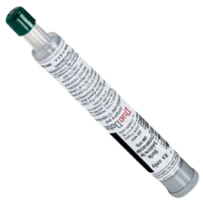 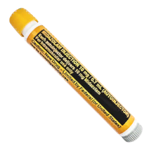

| Drug | Uses | Dose | Onset | Peak | Lasts | Heart rate | Blood pressure | Breathing |
| --- | --- | --- | --- | --- | --- | --- | --- | --- |
| Penthrox inhaler | 8 | 1 to 5 uses | Under 3 s | Under 90 s | About 4 min | Down |  |  |
| Naloxone spray | 1 | 1 to 2 uses | Under 3 s | About 2 min | About 6 min |  |  |  |
| Ammonia inhalant | 8 | 1 use | Under 3 s | Under 6 s | Under 40 s | Up | Up strongly |  |
| ATNA autoinjector | 1 | 2 to 3 injections to start | Under 15 s | About 10 min | About 15 min | Up strongly | Up |  |
| Midazolam autoinjector | 1 | 1 injection | Under 30 s | About 15 min | About 20 min | Down | Down |  |

Penthrox:

- Moderate pain relief. The only step up from paracetamol at this level.
- Do not use it with a chest injury, slow breathing, low blood volume or altered mental status.

Naloxone:

- Give it to any casualty in cardiac arrest or with falling saturation who has had morphine or fentanyl.
- It wears off in about 6 minutes. Opioids last 15 to 30. Watch and re-dose.

Ammonia inhalant:

- Only for an unconscious casualty with stable vitals. It does not fix the reason they are out.

ATNA and midazolam:

- ATNA treats nerve agent. Midazolam stops the seizures. See the CBRN guide.

## Level 3: Medic

### Drawing and giving

Vial drugs are drawn into a syringe, then given IV or IM. Volume to draw is dose divided by concentration.

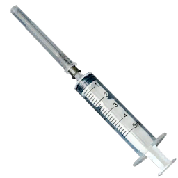

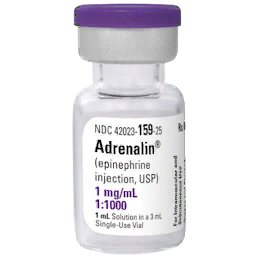 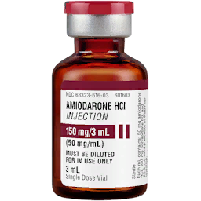 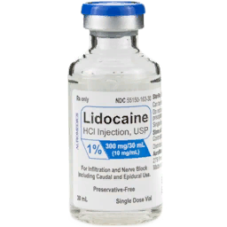 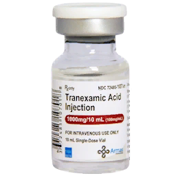 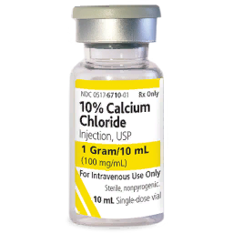 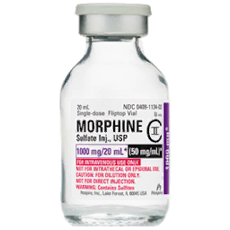 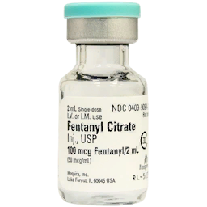 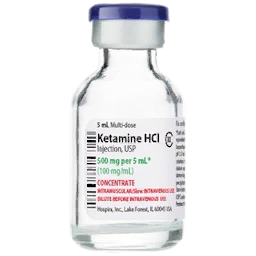 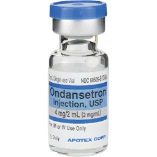 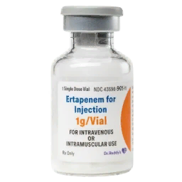 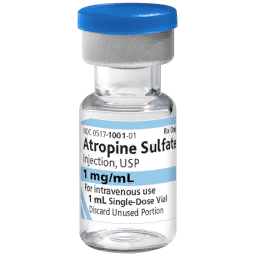 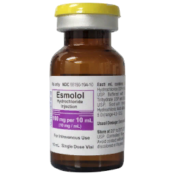 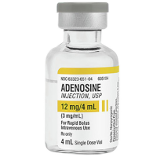

- Syringes come in 1, 3, 5 and 10 ml.
- IV drugs need an IV or IO in place first. IM drugs need no access.
- IV acts faster than IM for every drug that offers both.
- Dose by patient weight. Weight is fixed per player in multiplayer and random on AI.
- More than the dose range adds side effects, not benefit.

Fixed doses:

| Drug | Dose | Concentration | Draw |
| --- | --- | --- | --- |
| Epinephrine | 1 mg | 1 mg/ml | 1 ml |
| Amiodarone | 300 mg | 50 mg/ml | 6 ml, two vials |
| Lidocaine, IV or IM | 100 mg | 20 mg/ml | 5 ml |
| TXA | 1 g | 100 mg/ml | 10 ml |
| Calcium chloride | 1 g | 100 mg/ml | 10 ml |
| Ertapenem | 1 g | 312.5 mg/ml | 3.2 ml |
| Ondansetron | 4 mg | 2 mg/ml | 2 ml |
| Atropine, nerve agent | 2 mg | 1 mg/ml | 2 ml, two vials |
| Adenosine | 6 mg | 3 mg/ml | 2 ml |

Weight doses, worked for an 80 kg patient:

| Drug | Route | Range per kg | Dose at 80 kg | Draw |
| --- | --- | --- | --- | --- |
| Morphine | IV | 0.05 to 0.1 mg | 4 to 8 mg | 0.8 to 1.6 ml |
| Morphine | IM | 0.07 to 0.1 mg | 5.6 to 8 mg | 1.1 to 1.6 ml |
| Fentanyl | IV | 0.5 to 1 mcg | 40 to 80 mcg | 0.8 to 1.6 ml |
| Fentanyl | IM | 0.7 to 1 mcg | 56 to 80 mcg | 1.1 to 1.6 ml |
| Ketamine | IV | 0.1 to 0.2 mg | 8 to 16 mg | 0.16 to 0.32 ml |
| Ketamine | IM | 0.4 to 0.8 mg | 32 to 64 mg | 0.64 to 1.28 ml |
| Lidocaine | IV | 1 mg, max 3 mg | 80 mg, max 240 mg | 4 ml, max 12 ml |
| Esmolol | IV | 0.25 to 0.5 mg | 20 to 40 mg | 2 to 4 ml |

### Pain

Ketamine if breathing is impaired or the chest is injured, otherwise morphine or fentanyl.

| Drug | Vial | Onset IV / IM | Peak IV / IM | Lasts IV / IM | Strength | Vitals |
| --- | --- | --- | --- | --- | --- | --- |
| Morphine | 10 mg / 2 ml | Under 25 s / under 2 min | 15 / 20 min | 21 / 30 min | Strong | Lowers heart rate, blood pressure, breathing |
| Fentanyl | 100 mcg / 2 ml | Under 10 s / under 30 s | 14 / 15 min | 16 / 20 min | Very strong | Lowers heart rate, blood pressure, breathing |
| Ketamine | 500 mg / 10 ml | Under 5 s / under 20 s | 9 / 10 min | 11 / 15 min | Strong | None |
| Fentanyl lozenge | 1 lozenge | Under 2 min | 10 min | 15 min | Very strong | Lowers breathing most |

- Fentanyl lozenge: the casualty must be conscious and lying down.
- Consider ondansetron 4 mg after ketamine.
- IM lidocaine 50 to 100 mg before fracture realignment or thoracostomy.

### Cardiac

Epinephrine for every arrest, plus amiodarone or lidocaine when the rhythm is shockable.

| Drug | Route | Vial | Dose | Onset | Peak | Lasts | Vitals |
| --- | --- | --- | --- | --- | --- | --- | --- |
| Epinephrine | IV, IM | 1 mg / 1 ml | 1 mg | Under 5 s IV, under 30 s IM | 4 min | 6 to 7 min | Raises heart rate, blood pressure, breathing |
| Amiodarone | IV | 150 mg / 3 ml | 300 mg, max 2200 mg | Under 10 s | 8 min | 12 min | Lowers heart rate, blood pressure |
| Lidocaine | IV | 100 mg / 5 ml | 1 mg/kg, max 3 mg/kg | Under 5 s | 6 min | 10 min | Lowers heart rate, blood pressure |
| Atropine | IV, IM | 1 mg / 1 ml | 1 mg for slow heart rate | Under 5 s IV, under 15 s IM | 10 min | 15 min | Raises heart rate |
| Esmolol | IV | 100 mg / 10 ml | 0.25 to 0.5 mg/kg | Under 20 s | 4 min | 5 min | Lowers heart rate |
| Adenosine | IV | 12 mg / 4 ml | 6 mg | Under 1 min | 25 s | Under 2 min | Lowers heart rate |

From the cardiac arrest study:

| Treatment | Average time to pulse |
| --- | --- |
| CPR only, asystole | 1:37 |
| Epinephrine 1 mg, asystole | 0:47 |
| Morphine 5 mg on board, asystole | 3:57 |
| Amiodarone 300 mg, VF, shocked | 0:52 |
| Lidocaine 100 mg, VF, shocked | 0:57 |

- Epinephrine is the only drug that helps in asystole.
- Amiodarone only works at 300 mg.
- Lidocaine is one vial and one 5 ml syringe, so it is faster to give than amiodarone.
- Atropine corrects a slow heart rate after amiodarone.

### Bleeding, blood and the rest

| Drug | Route | Vial | Dose | Onset | Lasts | When |
| --- | --- | --- | --- | --- | --- | --- |
| TXA | IV | 1 g / 10 ml | 1 to 2 g | Under 15 s | 15 min | Severe bleeding, bruising, bleeding hemothorax |
| Calcium chloride | IV | 1 g / 10 ml | 1 g | Under 15 s | 10 min | After the first unit of blood, then after every 4 units |
| Ondansetron | IV, IM | 4 mg / 2 ml | 4 mg, max 8 mg | Under 15 s IV, under 45 s IM | 12 to 15 min | Nausea and vomiting, after ketamine |
| Ertapenem | IV, IM | 1 g / 3.2 ml | 1 g | Under 5 s IV, under 30 s IM | 15 to 20 min | Wound infection. Before casualty conversion if the mission requires it |
| Atropine | IV, IM | 1 mg / 1 ml | 2 to 4 mg to start | Under 5 s IV, under 15 s IM | 15 min | Nerve agent |

- TXA strengthens clots, inside and out. It lowers blood pressure slightly.
- A unit of blood is 500 ml. Skipping calcium ends in a casualty who cannot clot.
- Epinephrine autoinjector: 1 use, IM, lasts about 7 minutes, raises heart rate, blood pressure and breathing. The wiki lists no use for it. The unit medication notes list anaphylaxis.

## Do not mix

| Rule | Why |
| --- | --- |
| No amiodarone and lidocaine within 5 to 10 minutes of each other | Heart rate drops to the 40s, with hypoxia |
| No second amiodarone dose within 5 to 10 minutes | Same |
| No opioids with low blood volume, slow heart rate, slow breathing, chest injury or altered mental status | They lower all three vitals |
| Naloxone for any arrest with opioids on board | Opioids more than double time to pulse |
| No Penthrox with a chest injury or slow breathing | Lowers heart rate |
| Calcium chloride never IM | Unit medication notes |
| No calcium chloride in ventricular fibrillation | Unit medication notes |
| No epinephrine with a very fast heart rate or high blood pressure | It raises both |
| No esmolol, adenosine, amiodarone or midazolam with a slow heart rate | They lower it further |
| Morphine autoinjector not issued | Unit medication notes: 10 mg is the lethal dose in ACM. The wiki lists it as a 5 mg equivalent |

The wiki and the unit medication notes disagree on some doses. This guide uses the wiki's numbers. Where the notes differ: fentanyl IM 2 mcg/kg, morphine 5 to 8 mg, epinephrine lasting 16 to 20 minutes.
