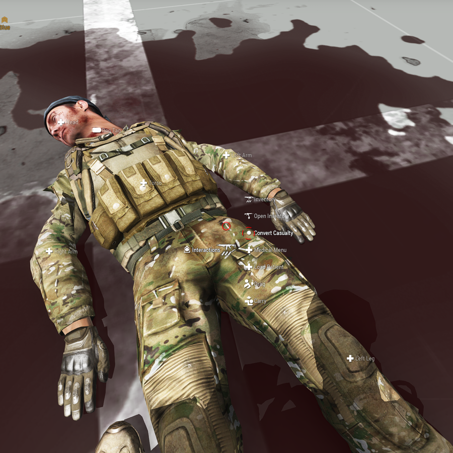
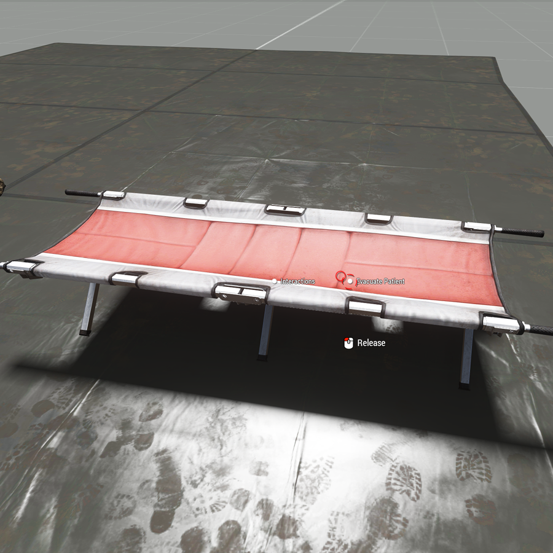

# ACM Evacuation Guide

## What it is

Casualty conversion turns an unconscious player into an AI casualty and sends the player back to the reinforcement area.

- The player stops waiting on the ground and rejoins by transport from the reinforcement area.
- The AI casualty stays where it fell. It still needs treatment and evacuation.
- Medical gameplay does not change. Only the time a player spends unconscious does.
- It needs mission-side setup and ACM settings before it works.

## Requirements

All of these must be true before the convert action appears.

| Requirement | Always or by setting |
| --- | --- |
| Casualty is unconscious | Always |
| Casualty is alive | Always |
| Casualty is not bleeding externally | Always |
| Casualty tickets remain | Always |
| Casualty is in a medical facility or vehicle | By setting |
| Medic has the required medic trait | By setting |
| Ertapenem has been given | By setting |

Ertapenem dose is 1 g, IV or IM. It is a vial medication, so the Medic gives it.

## Convert

Convert once the casualty is stable and will be down for a while.

1. Stop all external bleeding.
2. Move the casualty to a medical facility or vehicle, if the mission requires it.
3. Give ertapenem, if the mission requires it.
4. Use the convert action on the casualty.

The player goes to the reinforcement area. The AI casualty stays with you.

## Evacuate

Carry the converted casualty to the evacuation object and use the evacuate action.

1. Keep treating the AI casualty. It can still die.
2. Carry it to the evacuation object set by the mission.
3. Use the evacuate action on that object while carrying.

## Tickets

Converting costs a casualty ticket and evacuating gives it back.

| Event | Effect |
| --- | --- |
| Convert a casualty | Uses 1 casualty ticket |
| Evacuate the converted casualty | Returns the casualty ticket |
| Converted casualty dies | Counts as a player death and uses 1 respawn ticket |
| No casualty tickets left | No more conversions |
