# ACM Medic Guide

## MARCH

Treat every casualty in MARCH order. Do not move to the next letter until the current one is controlled.

1. M, massive hemorrhage: stop external bleeding, TXA for the rest.
2. A, airway: open it and keep it open.
3. R, respiration: seal, decompress or drain the chest.
4. C, circulation: access, fluids, blood, and the heart.
5. H, head injury and hypothermia: consciousness, then pain and fractures.

Soldiers use the short form, the 3 Bs: Bleeding, Breathing, Beating. Related guides: Drugs, CBRN, MIST report, CASEVAC, Evacuation.

## Scope

The Medic does everything CLS does, plus anything that needs a vein, a scalpel or a rhythm decision.

- IV and IO access, fluids, blood, field transfusion
- All vial medications
- i-gel, ACCUVAC, surgical airway
- Stethoscope, thoracostomy, chest tube, BVM
- Manual AED
- Fracture realignment
- Casualty conversion and evacuation

## Kit

Everything in the CLS kit, plus:

- 16g and 14g IVs, FAST1 IO, EZ-IO
- Saline, plasma, whole blood, field blood transfusion kits
- Syringes: 1, 3, 5 and 10 ml
- Vials: epinephrine, TXA, ketamine, fentanyl, morphine, amiodarone, lidocaine, calcium chloride, ondansetron, ertapenem, atropine, esmolol, adenosine
- i-gel, ACCUVAC, CricKit, BVM
- Stethoscope, thoracostomy kit

Quantities are not set yet.

## M: Massive hemorrhage

Give TXA 1 g IV for severe bleeding, noticeable bruising or a bleeding hemothorax.

- TXA is IV only. Dose 1 to 2 g. Onset under 15 seconds, lasts about 15 minutes.
- It strengthens clots and helps stop internal and external bleeding.
- Internal bleeding shows as bruising and a falling blood pressure. Treat with TXA and fluids.
- Clots are unstable. Wrap or stitch them once the casualty is stable.
- Platelets run out during a long bleed. Fluids replenish them. See Fluids.

## A: Airway

Use the least invasive airway that solves the problem.

| Tool | Solves | Notes |
| --- | --- | --- |
| i-gel | Open airway, collapse, vomit obstruction | Airway must be clear first. Consumable |
| ACCUVAC | All obstructions | Reusable, bulky |
| Suction bag | All obstructions | Consumable |
| Surgical airway | Collapse, obstruction, inflammation, spasm | Needs a CricKit. Most invasive |

i-gel, CricKit, ACCUVAC, suction bag:

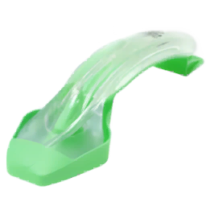  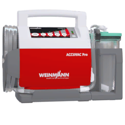 

- Severe airway inflammation from chlorine or lewisite needs a surgical airway. Some adjuncts will not go in.
- Airway spasm from nerve agent: antidote and anticonvulsant first, surgical airway if it does not open.
- Continuous CPR with BVM needs two medics and an i-gel. Otherwise it is 30 compressions, then 2 breaths.

## R: Respiration

Seal first, then decompress or open the chest depending on what you find.

Stethoscope, thoracostomy kit, chest tube kit, BVM, pocket BVM, oxygen tank:

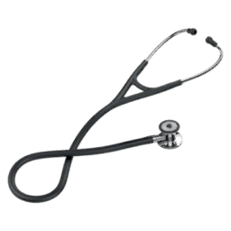 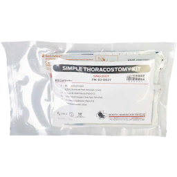 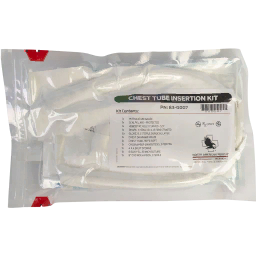 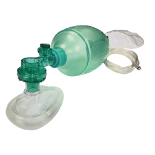 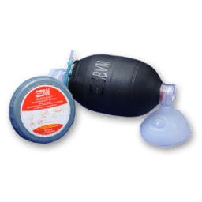 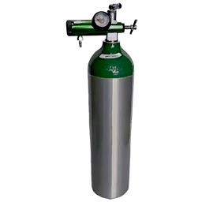

- Stethoscope: muffled breathing on one side means pneumothorax. Also gives respiratory rate and heart rate.
- Tension pneumothorax: chest seal plus NCD, or thoracostomy.
- Hemothorax: TXA, then thoracostomy and chest tube.
- Consider IM lidocaine before thoracostomy.

Where to listen:

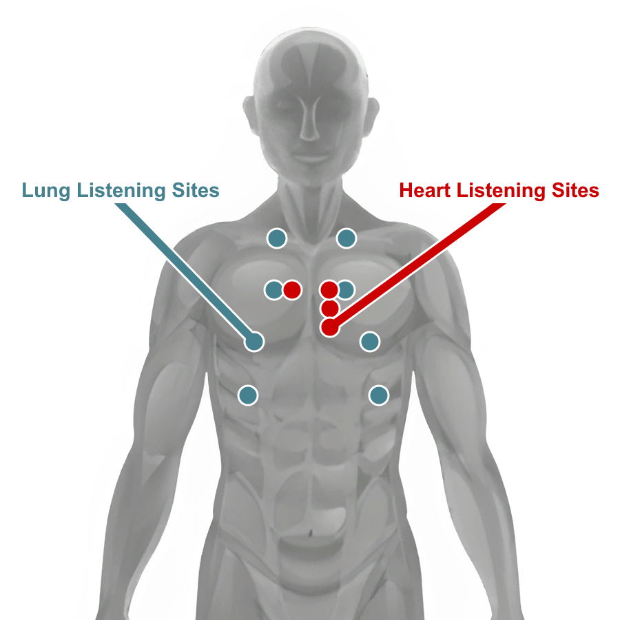

Finger thoracostomy findings:

| Finding | Action |
| --- | --- |
| Lung inflating normally | Close incision |
| Lung not inflating or severely collapsed | Close incision |
| Blood in pleural space | Chest tube |
| Active bleeding in pleural space | TXA, then chest tube |

Chest tube:

1. Drain with the ACCUVAC or a suction bag.
2. Re-drain until no blood comes out.
3. Close the incision.

## C: Circulation, access and fluids

Get an IV if a limb allows it, otherwise an IO, and give the best fluid you have.

| Access | Site | Flow | Notes |
| --- | --- | --- | --- |
| 16g IV | Limbs | Moderate | Some chance of complications |
| 14g IV | Limbs | Fast | High chance of complications |
| FAST1 IO | Sternum | Slow | Fast to insert |
| EZ-IO | Tibia or humerus | Slow | Fast to insert |

16g IV, 14g IV, FAST1 IO, EZ-IO:

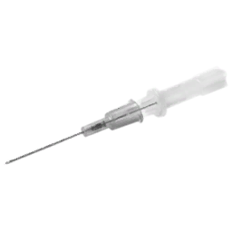 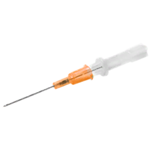 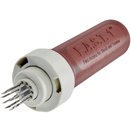 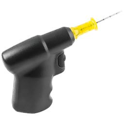

- IVs in damaged limbs can cause pain, slow flow or leakage. Inspect the IV: swelling at the site means a leak.
- Tourniquets and limb damage affect IV lines.
- Start with an IO on a crashing casualty, then move the bags to an IV when one is available. Bags move between lines without losing contents.

| Fluid | Replaces oxygen-carrying volume | Flow | Platelets |
| --- | --- | --- | --- |
| Fresh whole blood | Yes, at once | Fast | Yes, with calcium |
| Whole blood | Yes, at once | Slow | Yes, with calcium |
| Plasma | 30% | Moderate | Yes |
| Saline | No | Fast | No |

Saline, plasma, blood, field blood transfusion kit:

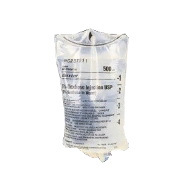 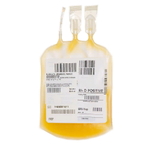 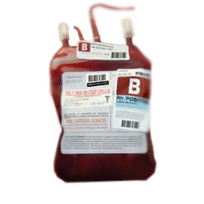 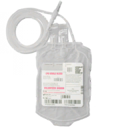

Priority: fresh whole blood, whole blood, plasma, saline.

The transfusion menu:

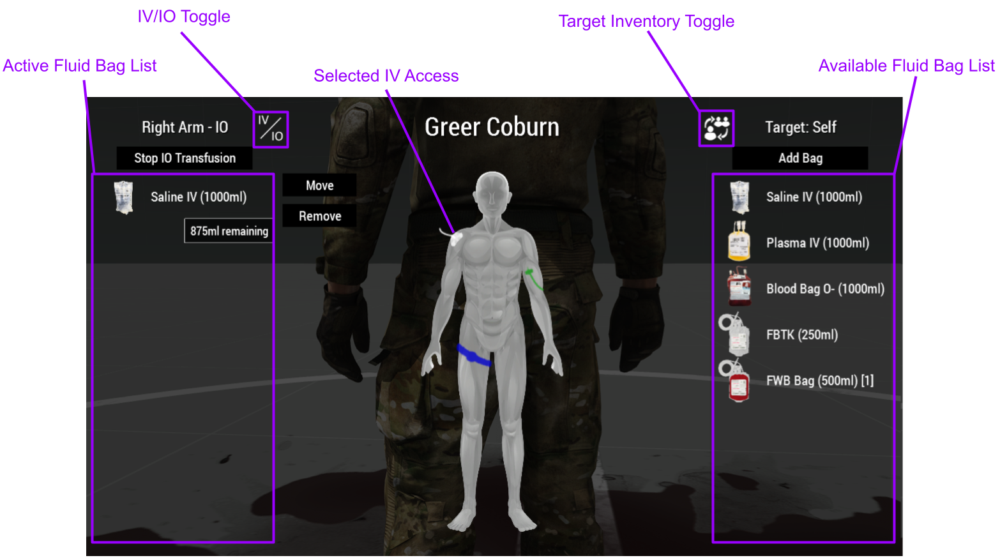

Blood:

- Check blood type on the dog tag. A mismatch can kill the recipient.
- O- can go to anyone. AB+ can receive from anyone. A negative recipient only takes negative blood.
- Calcium chloride 1 g IV after the first unit (500 ml), then 1 g after every 4 units. Never IM. Without it the casualty stops clotting.

Field transfusion:

1. Connect a field blood transfusion kit to the donor's IV. It does not work on an IO.
2. Wait for it to fill.
3. Disconnect and use it as a fresh whole blood bag. Use it soon. It degrades to whole blood.

A filled kit:

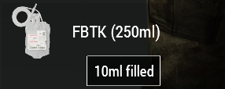

## C: Circulation, cardiac arrest

Confirm with a carotid pulse check, fix the reversible cause, then run rhythm, drug, shock, CPR.

Reversible causes:

| Cause | Action |
| --- | --- |
| Hypovolemia | IO, push fluid, CPR |
| Hypoxia | CPR with BVM |
| Tension pneumothorax | NCD or thoracostomy |
| Hemothorax | TXA, thoracostomy, chest tube |
| Opioids on board | Naloxone |

Manual AED:

| Rhythm | Shock | Action |
| --- | --- | --- |
| Sinus | No | Re-assess |
| VT or VF | Yes | Amiodarone or lidocaine, shock, CPR |
| PEA | No | Re-check reversible causes, CPR |
| Asystole | No | Check for terminal injuries, epinephrine, CPR |

Sinus:

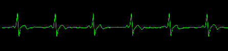

Pulseless ventricular tachycardia:

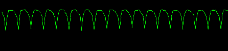

Ventricular fibrillation:

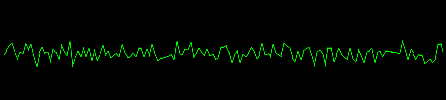

Asystole:

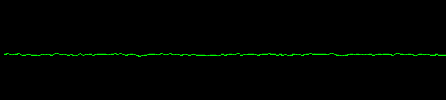

PEA looks like sinus on the EKG. Always confirm with a pulse check.

AED and pressure cuff:

 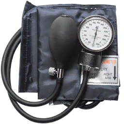

Drugs:

- Epinephrine 1 mg IV. Roughly halves time to pulse: 0:47 against 1:37 in testing. It is the only drug that helps in asystole.
- Amiodarone 300 mg IV for VT or VF. That is two vials. Smaller doses do nothing.
- Lidocaine 100 mg IV for VT or VF. One vial, 5 ml syringe. Similar result to amiodarone in testing: 0:57 against 0:52.
- Do not give amiodarone and lidocaine together. Leave 5 to 10 minutes between them. Together they cause heart rates in the 40s and hypoxia.
- Do not repeat amiodarone within 5 to 10 minutes.
- Naloxone for anyone with morphine or fentanyl on board. 5 mg of morphine took time to pulse from 1:37 to 3:57.

CPR:

1. 2 minutes, or until the AED prompts.
2. Oxygen-deprived casualty, one medic or no i-gel: 30 compressions, then 2 BVM breaths.
3. Oxygen-deprived casualty, two medics and an i-gel: continuous CPR and BVM.
4. No oxygen deprivation: continuous CPR.
5. Re-analyze and repeat.

- Signs the pulse is back: EtCO2 jumps to 40 to 50, cyanosis fades, carotid pulse returns.
- Saturation drops 10 to 30% during CPR even at full blood volume.
- The chance of getting a pulse back depends on CPR consistency, drugs, recent shocks, blood volume and the medic's trait.

## H: Head injury and hypothermia

The ACM wiki overview lists no head injury or hypothermia mechanics, so H is the consciousness check, then pain and fractures.

A casualty is out for one of four reasons, and stays out until it is fixed: pain past the threshold, low blood pressure, cardiac arrest, or saturation under 90. The game checks the vitals every 15 seconds.

- Unconscious with stable vitals: ammonia inhalant.
- Still unconscious: go back through M, A, R, C. Saturation under 80 keeps a casualty out; so do pain and pressure.
- Conscious: manage pain, then fractures.

## Pain

Ketamine if breathing is impaired or the chest is injured, otherwise morphine or fentanyl.

| Situation | Drug | Dose |
| --- | --- | --- |
| Breathing impaired or chest injury | Ketamine | IV 0.1 to 0.2 mg/kg, IM 0.4 to 0.8 mg/kg |
| No breathing problems | Morphine | IV 0.05 to 0.1 mg/kg, IM 0.07 to 0.1 mg/kg |
| No breathing problems, severe | Fentanyl | IV 0.5 to 1 mcg/kg, IM 0.7 to 1 mcg/kg |
| Conscious, no IV | Fentanyl lozenge | 1 lozenge |
| Before realignment or thoracostomy | Lidocaine | IM 50 to 100 mg |

- Dose by weight. More than the range adds side effects, not relief.
- Opioids lower heart rate, blood pressure and breathing. Avoid them with low blood volume, slow heart rate, slow breathing, chest injury or altered mental status.
- Opioids make cardiac arrest much harder to reverse. Carry naloxone.
- Consider ondansetron 4 mg after ketamine.
- Fentanyl lozenge: the casualty must be conscious and lying down.
- Morphine autoinjector is not issued. The unit medication notes treat it as unsafe.

## Drugs

Doses, timings, draw volumes and interactions for every drug are in the [ACM Drugs Guide](drugs.md).

## Fractures

Realign, then splint. That restores sprint. A splint alone only allows a jog.

1. Check for fracture.
2. Lidocaine 50 to 100 mg IM.
3. Fracture realignment.
4. SAM splint.
5. Check mobility. If still limited, redo the realignment and splint.
6. Wrap the splint.

Complex fractures (significant swelling) cannot be fixed in the field. Evacuate.
