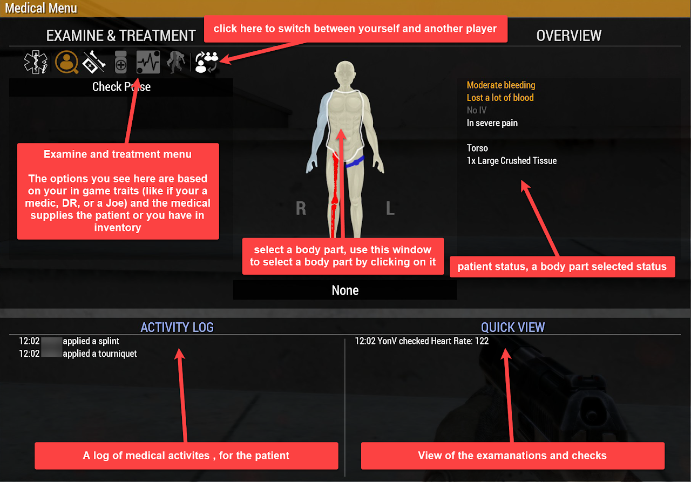
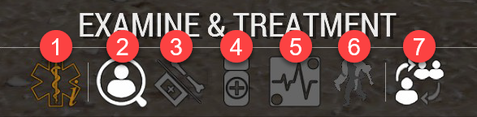

# ACM Medical Menu

## The menu

Open it on a casualty (or yourself) from the ACE interaction menu, Medical, Open medical menu. Everything medical in the game happens in this one window.

- Examine and treatment, top left: what you can do to the selected body part. The options you see depend on your skill (soldier, CLS, Medic) and on what is in your inventory and the casualty's.
- The body, middle: click a body part to select it. The selected part is outlined.
- Overview, top right: the casualty's state, then the selected body part's wounds.
- Activity log, bottom left: what has been done to this casualty, by whom and when.
- Quick view, bottom right: the results of the checks you have made (pulse, blood pressure, breathing).

## The seven tabs

1. Triage card: the history of treatment, and the casualty's triage status.
2. Diagnose: pulse, blood pressure, responsiveness, breathing, inspect chest.
3. Bandages and fractures: bandages, wraps, tourniquets, splints.
4. Medication: autoinjectors, inhalers, pills, and for the Medic the drawn-up drugs.
5. Advanced treatment: the Medic's airway, chest and IV work. CPR is in here too, and anyone can do CPR.
6. Drag and carry.
7. Toggle self: switch the menu between you and the casualty.

## Reading the body

The body colours tell you where to go first.

| Colour | Meaning |
| --- | --- |
| Red | Open wounds, severe bleeding |
| Orange | Open wounds, moderate bleeding |
| Yellow | Open wounds, minor bleeding |
| Light blue | Bruised |
| Dark blue | Fully bandaged |
| Blue band | Tourniquet on that limb |
| Red bone | Fractured |
| Blue bone | Splinted |

## Reading a wound

The overview names every wound on the selected body part, with its size and type. The type tells you how much it hurts and how fast it bleeds.

| Wound | Caused by | Pain | Bleeding |
| --- | --- | --- | --- |
| Avulsion | Explosions, shrapnel; a piece of the body torn away | Extreme | Extremely fast |
| Velocity wound | Bullets and shrapnel | Extreme | Medium |
| Laceration | Large force on the body; ragged edges | Slight | Slow |
| Cut | Sharp edges | Slight | Slow |
| Puncture | A narrow sharp object | Slight | Slow |
| Crush | Blunt force, vehicle crashes, falls | Moderate | Slow |
| Abrasion | Friction, rope burn, vehicle crashes | Low | Extremely slow |
| Contusion | Blunt force without breaking the skin; a bruise | Low | None, but internal |

When a body part has several wounds, treat them in this order: avulsion, velocity, laceration, cut, puncture, crush, abrasion, contusion. The bleeding is what kills; the bruise can wait.

## Why a casualty is out

A casualty goes unconscious when any one of these is true, and cannot wake up until it is fixed.

- Pain past the threshold.
- Blood pressure too low.
- Cardiac arrest.
- Oxygen saturation under 90.

While unconscious the game checks the vitals every 15 seconds; a casualty with stable vitals and none of the four can be woken with an ammonia inhalant, or wakes on their own.

- A tourniquet left on hurts. Left on long enough it puts the casualty out on pain alone. Take it off once the wounds under it are bandaged.
- Death is delayed in our settings. The unit's aim is to treat and recover every casualty on the battlefield, not to respawn.
- AI go unconscious the same way and can be revived the same way.
