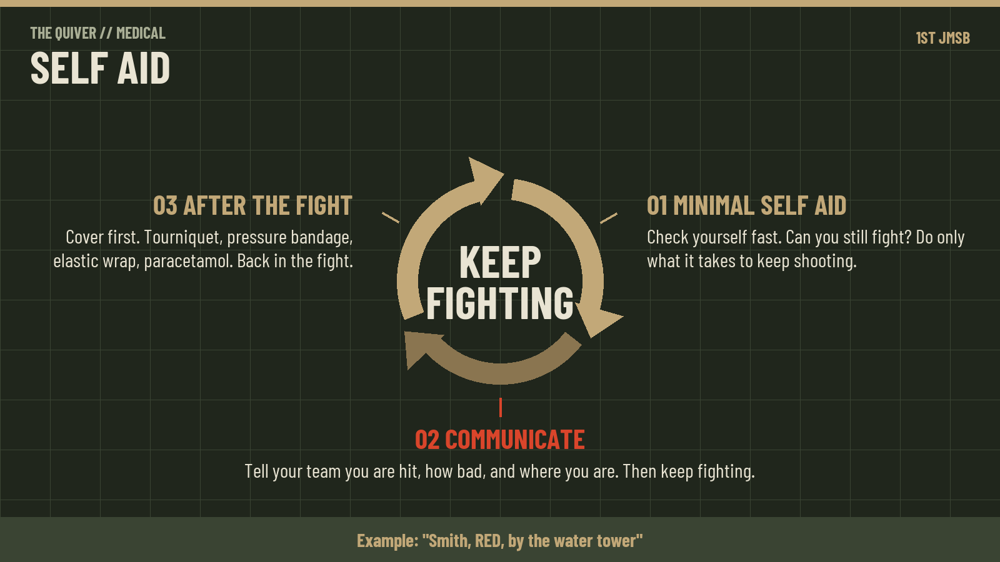
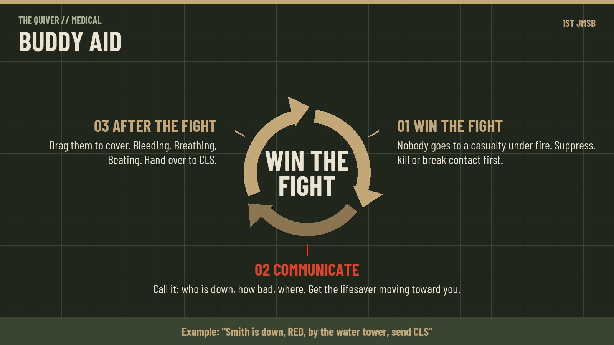
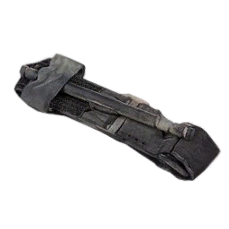
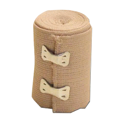
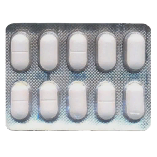

# ACM First Aid: Soldier

## The 3 Bs

There is no first aid in a firefight. Win the fight, then provide aid. A soldier who stops shooting to bandage a buddy makes two casualties.

Self aid and buddy aid are three checks, always in this order: Bleeding, Breathing, Beating.

1. Bleeding: stop it.
2. Breathing: is the casualty breathing, and is the airway open?
3. Beating: is there a pulse?

- Self aid is what you do to yourself. Buddy aid is what you do for the soldier next to you.
- The 3 Bs are the short form of MARCH, which CLS and Medics use.
- CBRN has its own guide, with a self aid and buddy aid section.

## Scope

Every soldier stops bleeding, keeps an unconscious buddy's airway open, and calls CLS. Nothing else.

- You do: tourniquet, pressure bandage, elastic wrap, pulse and breathing checks, head turn, recovery position, CPR, paracetamol.
- You do not: airway adjuncts, chest seals, needles, IVs, any medication other than paracetamol.
- Call CLS for: any unconscious casualty, any chest wound, bleeding you cannot stop, a limb that will not work.

## Kit

- Tourniquets
- Pressure bandages
- Elastic wraps
- Paracetamol

Quantities are not set yet.

## Self aid

Self aid is what you do to yourself. You are conscious, so it is the first B and pain.

1. Win the fight. Return fire, get to cover, and only then look at yourself.
2. Tourniquet any limb with many wounds.
3. Pressure bandage every other wound.
4. Elastic wrap once the bleeding has stopped.
5. Paracetamol for pain.
6. Call CLS if you cannot stop the bleeding or a limb will not work.
7. Get back in the fight. A bandaged soldier is a soldier.

## Buddy aid

Buddy aid is what you do for the soldier next to you. They may be unconscious, so you work all three Bs, not just the first.

1. Win the fight. Do not go to a casualty under fire. Suppress, kill or break contact, then move.
2. Drag your buddy to cover. Treat behind cover, never where they fell.
3. Stop the bleeding. Tourniquet any limb with many wounds. Pressure bandage every other wound. Head wounds first, then limbs, then the rest.
4. Are they responsive? Yes: finish bandaging, elastic wrap the bandaged wounds, give paracetamol, done. No: call CLS and keep going.
5. Are they breathing? Yes: go on. No: turn the head to clear the mouth and check again.
6. Is there a pulse at the neck? No: CPR. 2 minutes, check the pulse, repeat until CLS takes over. Yes: recovery position, stay with them.
7. Tell CLS what you found and what you did. The handover is at the bottom of this page.

- Responsive means they answer you. An unresponsive casualty is the one the 3 Bs are for.
- Do not put a casualty with no pulse in the recovery position. It blocks CPR.

## Bleeding

Unstopped bleeding leads to unconsciousness, cardiac arrest and death. Stop it first, on yourself or on your buddy, with the same three items in the same order.

1. Limb with many wounds: tourniquet. High and tight, above the wounds.
2. Everything else: pressure bandage. One per wound. This is the only bandage you can put on yourself, and the one that does most of the work in self and buddy aid.
3. Once bleeding has stopped: elastic wrap over bandaged or clotted wounds so they do not reopen.

Tourniquet and elastic wrap:

 

- A pressure bandage stops the bleeding; an elastic wrap keeps it stopped. Elastic wrap does not stop a bleeding wound on its own.
- Small wounds may clot by themselves. Clots are unstable. Wrap them.
- Head wounds on an unconscious casualty come first. Blood runs into the airway.
- Tell CLS which limbs have tourniquets. A tourniquet blocks IVs on that limb.
- A tourniquet left on hurts, enough to put the casualty out. Once CLS has bandaged the wounds under it, it comes off.

## Breathing

An unconscious casualty's tongue falls back and blocks the airway, so the airway has to be held open.

Check breathing tells you one of four things:

| Result | What to do |
| --- | --- |
| Not breathing | Head turn, check pulse, call CLS |
| Shallow | Chest injury or closing airway. Call CLS |
| Slow or rapid | Tell CLS |
| Normal | Recovery position |

- Head turn clears slight blockages from the mouth.
- The recovery position keeps the airway open and drains vomit and blood.
- The recovery position blocks most other treatment. CLS will roll the casualty back when they need to work.
- Blue skin on the face and arms means the casualty is short of oxygen. Tell CLS.

## Beating

No pulse at the neck means cardiac arrest, and CPR is the only thing you can do about it.

1. Check the pulse at the head.
2. No pulse: CPR for 2 minutes.
3. Check the pulse again.
4. Repeat until the pulse returns or CLS takes over.

- A weak or missing pulse at the arms or legs means heavy blood loss. Tell CLS.
- Do not put a casualty with no pulse in the recovery position. It blocks CPR.

## Pain

Paracetamol is the only painkiller a soldier carries.

- Dose: 1 to 2 pills.
- Starts working in about 4 minutes and lasts about 50.
- It is weak. For worse pain, ask CLS.

## Handover to CLS

Tell CLS four things when they arrive.

1. What happened and how long the casualty has been down.
2. Where the tourniquets are.
3. Whether there is a pulse and breathing.
4. Whether you gave paracetamol and how many pills.
